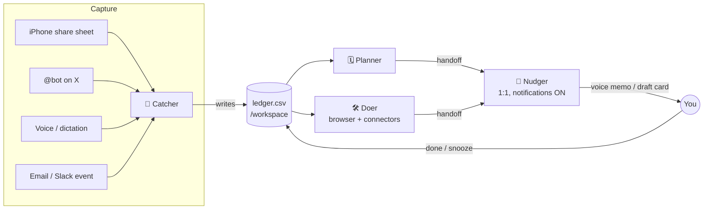

I read through the docs you pasted. They change parts of my earlier answer: Grok Bot already includes schedules, push notifications, memory, and bot-to-bot coordination, so you don't need to build those yourself. The real limits are elsewhere: it can't see what's happening on your phone, it can't take video posts from X, and users need a paid plan to use it.

I still couldn't open the Marketplace page itself. The docs only say that Marketplace appears in the sidebar and that you can **Add** or **Import** bots from it.

---

## 1. What Grok Bot can do

| Feature | What the docs say | Why it matters for this product |
|---|---|---|
| **Persistent cloud computer** | A browser, files and terminal that keep running when your laptop or phone is closed | Bots can do real tasks in real apps, not just write suggestions |
| **Named Bots with memory** | Each Bot keeps its preferences, facts and summaries of past work | Bots get to know your habits over time |
| **Routines** | Scheduled or event-triggered jobs (Slack, GitHub). Up to 50 per Bot, at least 5 minutes apart | **Handles reminders on a schedule, built in** |
| **Notifications** | Push alerts per Bot when it finishes or needs your input | **This is how a Bot nudges you** |
| **Voice memos** | Bots can reply with audio | A short audio brief can compete with Reels for attention |
| **Group chats and handoffs** | 2–6 Bots per group. Bots can message each other and pass tasks along | **This is how you build a team of agents** |
| **Skills and "Teach a task"** | Save a process once, or show it in the browser (up to 10 min) and the Bot learns it | Teaches the Bots repeatable life-admin steps |
| **Ways to send things in** | iPhone share sheet (photo, file, link, text); Android (text only); @bot on X; voice; attachments (video up to 200 MB) | Lets people capture something the moment they see it |
| **Connectors and MCP** | Plugins with sign-in, custom MCP servers, read-only X search included | Access to email, calendar, Slack, X |
| **Approvals** | Draft cards with **Send** or **Discard**, Auto Review rules, a human takes over for passwords and payments | Bots can act without risky surprises |
| **Sharing** | Public or team-only templates, plus Team Bots in Slack | How you would distribute the product |

## 2. Limits that shape the design

| Limit (from the docs) | How to design around it |
|---|---|
| Approvals requested by routines **expire after about 10 minutes** | Background Bots should prepare drafts and wait. Don't rely on fast replies from people who forget |
| Routines **may be paused after a long time away** with no response | This is the biggest risk, because the target users are the ones who drift away. Make each brief take one tap to answer (I couldn't confirm whether a reaction counts as activity) |
| Notifications are **per Bot**. Group chats have no per-Bot switch, and alerts are muted while the app is open | Send nudges from a 1:1 Bot. Use group chats only for coordination between Bots |
| Approvals, email and Slack drafts **don't appear in group chats**, and handoffs there are text-only | Anything you need to act on goes through a 1:1 Bot |
| **@bot ignores posts with video or GIFs**, and isn't available in the UK, EU or Australia | Capturing from X works only for text and photo posts. For Reels, share the link or a screenshot |
| **No access to your phone's screen time or apps** | It can't detect when you're doomscrolling (see idea #9) |
| All Bots **share one computer** (files and logins) | Separate Bots don't keep data separate. Be careful with health and money data |
| Usage resets **weekly**, and broad triggers use it up | Run a few well-timed routines, not constant checking |
| Requires a **paid Cursor plan or a linked SuperGrok plan** | The first audience is X/Grok power users, not the general public |

---

## 3. The core design: a "Life Ops" team

The idea is an on-call system for your personal life. Bots share one task list stored as a file, `/workspace/life-ops/ledger.csv`, with columns for the item, source, due date, next nudge, owning Bot and status. They pass work to each other and nudge you at a few fixed times of day.

**Suggested Auto Review rules:** let Bots edit `/workspace/life-ops/` automatically. Make them ask first before sending email, buying anything, adding calendar events, or deleting anything.

---

## 4. Product ideas: groups of agents

### 🥇 Tier 1: Build these first

**1. Save-to-Do: makes saved posts actually useful**
- **Bots:** 🧲 Catcher (sorts everything you share) → 🗓 Planner (suggests a time slot on your calendar) → 🛠 Prepper (recipe → grocery list, workout → plan, place → trip list; fills a shopping cart but stops before checkout) → 🔔 Nudger ("one saved thing tonight," as a voice memo)
- **How it starts:** the iPhone share sheet, @bot on X ("@bot make this a Saturday plan"), plus an evening routine
- **Caveat:** Instagram and TikTok may block automated browsing or ask for a login. If so, share a screenshot or the video file instead

**2. Money & Deadlines Desk: handles life admin**
- **Bots:** 📥 Inbox Scout (daily email scan for bills, free trials, renewals and appointment letters) → 📎 Clerk (reads photos or PDFs of paper mail and logs deadlines with lead time) → ✂️ Canceller (walks through cancellation pages and stops at the final click for your approval) → 🔔 Nudger
- **Saves you from:** surprise charges, missed renewals, late fees
- **You could test it on yourself:** visa and work-permit dates, the March H-1B window, your passport, license and lease

**3. Morning Launch / Night Shutdown: a short daily habit**
- **Bots:** ☀️ Briefer (7 AM: calendar, task list, weather and relevant X news, turned into a voice memo under 60 seconds with 3 must-dos) → 🌙 Closer (9 PM: a quick form asking what got done; unfinished items roll to tomorrow) → 🧭 Coach (Sunday: what slipped and why, plus one change to try)
- **Why it works:** it's built to be as quick as the short videos it competes with

### 🥈 Tier 2: Strong, but for specific groups

| # | Product | Bots | Feasibility |
|---|---|---|---|
| 4 | **Promise Keeper** | Listener (scans email and Slack for "I'll send…" and things owed to you) → Drafter (email or Slack drafts you approve) → Tracker | ✅ High. This matches the documented Chief of Staff example |
| 5 | **Care Circle** (an older parent's meds and appointments) | Refill Watcher (pharmacy website; you handle the login) → Appointment Prep → Family Updater (draft emails to relatives) | ⚠️ Medium. Health data sits on the shared computer, and alerts go only to the account owner |
| 6 | **Household Hub** (roommates or family) | One Team Bot with shared memory, private notes for each person, and Slack | ⚠️ Medium-low. Needs the Cursor Teams plan, and routines are personal, not shared |

### 🥉 Tier 3: Add-ons or experiments

| # | Product | Notes |
|---|---|---|
| 7 | **Capture from X** | "@bot remind me Friday" while scrolling. A way to send things in, not a team of its own |
| 8 | **Learn-It-Later** | Saved educational content becomes weekly quizzes and voice-memo recaps on a routine |
| 9 | **Doomscroll Interrupter** | ❌ **Grok Bot can't do this by itself.** It can't see your phone. A possible workaround is an iOS Shortcut that runs when Instagram opens, posts to Slack, and triggers a routine. That's fragile, uses up your weekly allowance, and I haven't tested it |

---

## 5. Recommendation

**Start with #3 and #1, using one shared task list.** Together they create a daily habit, use what Grok Bot does well (voice memos, share-sheet capture, routines, push alerts), and only need read access to your calendar. Add **#2** next, once people trust the Bots with their email.

**Build plan:**
- [ ] Write a **Ledger skill** that defines the task list's columns and rules: no duplicates, snooze logic, and what to do when data is missing
- [ ] Create **Catcher** and test it with 10 real saved Reels, X posts and screenshots
- [ ] Create **Nudger** as a 1:1 Bot with notifications on and 2–3 routines a day, each tested with **Test run**
- [ ] Set up a **"Life Ops" group chat** so you can see the handoffs between Bots
- [ ] Add the **Auto Review rules** from section 3
- [ ] Use it yourself for 2 weeks, then share each Bot as a **public template** (templates carry over skills and routines but not memory or connectors)

**What I couldn't confirm:** what's listed in the Marketplace, how to get a bot listed there or charge for it, whether a whole group of Bots can be shared as one template, and whether reactions count as activity that keeps routines running.

If you paste the Marketplace page, I'll check it for overlap with these ideas. I can also save this plan as a markdown file.
