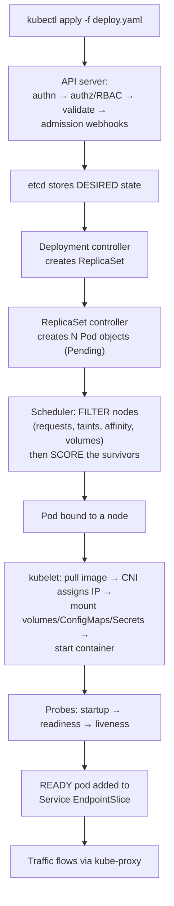

# 📘 The Complete Kubernetes + Linux Chapters + Full Answer Bank

**Friday Aug 28, 3:00 PM CDT. Join at 2:55.** Vidyasagar codes and goes deep.

**How to use this:** Read Part A and B once tonight/Wednesday for understanding. Then live in **Part C** — say those answers out loud. Part C is what comes out of your mouth Friday.

---

# 🅰️ PART A — THE KUBERNETES CHAPTER

## A1. Why Kubernetes exists (the 60-second version)

You have 50 containers across 10 machines. Someone has to decide which container goes on which machine, restart them when they die, give them stable addresses when their IPs keep changing, roll out new versions without downtime, and inject config and passwords.

**Kubernetes is that someone.** It's a **declarative reconciliation system**: you submit *desired state* ("3 replicas of this image"), and controllers continuously compare actual state to desired state and close the gap. You never tell it *how* — you tell it *what*.

🗣️ **Say this early:** *"The mental model I hold is declarative reconciliation — I submit desired state to the API server, and controllers run continuous loops driving actual state toward it. That's why deleting a pod doesn't remove it, it just triggers a replacement."*

---

## A2. Architecture — the components

### Control plane (the brain)

| Component | What it does | ELI5 |
|---|---|---|
| **kube-apiserver** | Front door for everything. Auth, RBAC, validation, admission. **Only component that talks to etcd.** | The receptionist — all requests go through here |
| **etcd** | Key-value store holding *all* cluster state | The filing cabinet. Lose it, lose the cluster |
| **kube-scheduler** | Picks which node each new Pod runs on | The seating host |
| **kube-controller-manager** | Runs the reconciliation loops (Deployment, ReplicaSet, Node, Job controllers…) | The managers who keep checking "is reality matching the plan?" |
| **cloud-controller-manager** | Talks to the cloud provider (load balancers, volumes, nodes) | The liaison to AWS/Azure |

### Every worker node

| Component | What it does |
|---|---|
| **kubelet** | The node's agent. Starts/stops containers, runs probes, reports status to the API server |
| **kube-proxy** | Programs iptables/IPVS so Service IPs route to the right pod IPs |
| **Container runtime** | `containerd` — actually runs the containers (Kubernetes dropped Docker as runtime in 1.24) |
| **CNI plugin** | Gives each pod an IP and makes pod-to-pod networking work (Calico, Cilium, AWS VPC CNI) |

**Prove you've seen it:** `kubectl get pods -n kube-system` shows apiserver, etcd, scheduler, controller-manager, kube-proxy, and coredns running as pods. You did this in the kind lab. Say so.

---

## A3. What happens when you deploy — the flow



**Rolling update version:** new ReplicaSet scales up while old scales down, governed by `maxSurge` and `maxUnavailable`. Readiness probes gate when a new pod starts receiving traffic. Old ReplicaSet is retained → rollback is just scaling it back up.

---

## A4. The objects — what each is for

### The workload hierarchy

```
Deployment  (manages versions & rollouts)
   └── ReplicaSet  (maintains N copies)
         └── Pod  (1+ containers sharing network + volumes)
               └── Container
```

| Object | Purpose | Use when |
|---|---|---|
| **Pod** | Smallest deployable unit. 1+ containers sharing an IP + volumes. **Ephemeral** — never self-heals | Almost never directly. Debug only |
| **ReplicaSet** | Keeps exactly N pods alive | Almost never directly — Deployments manage these |
| **Deployment** | Manages ReplicaSets → rolling updates, rollback history, scaling | **Default for stateless apps and services** |
| **StatefulSet** | Stable ordinal names (`kafka-0`), ordered startup, one PVC per pod | Kafka, Cassandra, databases, anything with identity |
| **DaemonSet** | Exactly one pod per node | Log collectors, node-exporter, Datadog/Splunk agents |
| **Job** | Run to completion, then stop. `backoffLimit`, `completions`, `parallelism` | Batch ETL, migrations, Spark drivers |
| **CronJob** | Job on a schedule | Nightly batch loads |
| **Service** | Stable virtual IP + DNS name in front of changing pods | Anything another workload needs to reach |
| **Ingress** | L7 HTTP routing, hostname/path rules, TLS termination | Exposing HTTP services externally |
| **ConfigMap** | Non-sensitive config as env vars or mounted files | Feature flags, connection strings, tuning params |
| **Secret** | Same, for sensitive data (base64 in etcd) | Passwords, tokens, keys |
| **Namespace** | Logical partition + scope for quotas and RBAC | Multi-team / multi-env isolation |
| **PVC / PV / StorageClass** | Storage request / actual volume / dynamic provisioner | Anything needing persistence |
| **HPA** | Autoscale replicas on CPU/memory/custom metrics | Variable load |
| **ResourceQuota / LimitRange** | Cap a namespace's total usage / set per-pod defaults | Shared clusters |
| **PodDisruptionBudget** | Minimum available pods during voluntary disruptions | Protects quorum during node drains/upgrades |
| **ServiceAccount + RBAC** | Workload identity + least-privilege permissions | Any pod calling the API or cloud services |

### Service types

| Type | What it does |
|---|---|
| **ClusterIP** (default) | Internal-only virtual IP + DNS |
| **NodePort** | Opens a port on every node (30000–32767) |
| **LoadBalancer** | Provisions a cloud load balancer |
| **Headless** (`clusterIP: None`) | No VIP — DNS returns pod IPs directly. For StatefulSets |
| **ExternalName** | DNS CNAME to an outside host |

---

## A5. 🔥 Probes — the highest-value 5 minutes in this chapter

| Probe | Question it answers | On failure |
|---|---|---|
| **startupProbe** | "Has it finished booting?" | Kills the container. **While running, it disables liveness/readiness** — protects slow starters |
| **readinessProbe** | "Can it serve traffic *right now*?" | **Removes the pod from Service EndpointSlices.** Does NOT restart. Pod stays Running but gets no traffic |
| **livenessProbe** | "Is it alive, or hung?" | **Restarts the container** |

```yaml
startupProbe:   { httpGet: {path: /healthz, port: 8080}, failureThreshold: 30, periodSeconds: 5 }
readinessProbe: { httpGet: {path: /ready,   port: 8080}, periodSeconds: 5,  failureThreshold: 2 }
livenessProbe:  { httpGet: {path: /healthz, port: 8080}, periodSeconds: 10, failureThreshold: 3, timeoutSeconds: 2 }
```

**The two production traps — mention at least one:**
1. **Aggressive liveness probe = self-inflicted outage.** Short timeout + low threshold kills healthy-but-slow containers in a loop. Use a startupProbe instead of a long `initialDelaySeconds`.
2. **Readiness that checks dependencies cascades failures.** If your readiness endpoint pings the database, a slow DB makes every pod un-ready simultaneously and you take a **total** outage instead of a degraded one. Liveness should check *the process*; readiness should check *this instance's ability to serve*.

🗣️ *"Readiness controls traffic, liveness controls restarts, startup protects slow boots. The mistake I watch for is a liveness probe that's too aggressive — it turns a slow start into a CrashLoop — and a readiness probe that checks downstream dependencies, which converts a degradation into a full outage."*

---

## A6. 🔥 Requests vs limits + QoS

| | Requests | Limits |
|---|---|---|
| **Used by** | The **scheduler** — reserves capacity | The **kubelet/kernel** — enforces a ceiling |
| **Meaning** | "Guarantee me at least this" | "Never let me exceed this" |
| **CPU over** | — | **Throttled** (compressible — slowed, not killed) |
| **Memory over** | — | **OOMKilled, exit 137** (incompressible — no way to slow it) |

**QoS classes** (determine eviction order under node pressure):

| Class | Condition | Evicted |
|---|---|---|
| **Guaranteed** | requests == limits for all containers | Last |
| **Burstable** | requests set, limits higher or absent | Middle |
| **BestEffort** | nothing set | **First** |

**What bad config causes:**

| Mistake | Consequence |
|---|---|
| No requests | Scheduler packs the node blind → noisy neighbors, node pressure, **BestEffort = evicted first** |
| Requests too high | Pods stuck **Pending** while the cluster looks half-idle; wasted spend |
| Memory limit too low | Constant **OOMKilled / CrashLoopBackOff** |
| CPU limit too low | Silent **throttling** — latency spikes with CPU "looking fine." Check `container_cpu_cfs_throttled_seconds_total` |
| Limits ≫ requests everywhere | Node oversubscribed → mass evictions under load |

**⭐ The Spark connection:** an executor pod's **memory limit must cover `spark.executor.memory` + `spark.executor.memoryOverhead`** — and PySpark worker processes live in *overhead*. If the limit is below that sum, the kernel kills the container **before Spark can spill to disk**, so you lose Spark's graceful degradation.

---

## A7. 🔥 Debug playbook 1 — Pod not starting

```bash
kubectl get pods -n <ns> -o wide             # STATUS + RESTARTS + node
kubectl describe pod <pod> -n <ns>           # ← Events (bottom) + Last State + exit code
kubectl logs <pod> -n <ns>
kubectl logs <pod> -n <ns> --previous        # ← the container that DIED. Most-missed command.
kubectl logs <pod> -c <container>            # multi-container / init containers
kubectl get events -n <ns> --sort-by=.lastTimestamp
kubectl top pod / kubectl top node
kubectl exec -it <pod> -- sh                 # if it stays up long enough
kubectl rollout undo deployment/<name>       # restore service first if prod is down
```

### Classify by status

| Status | Meaning | Fix |
|---|---|---|
| **Pending** | Not scheduled or not started | See A8 |
| **ContainerCreating** (stuck) | Image pull, volume mount, or CNI issue | `describe` Events |
| **ImagePullBackOff / ErrImagePull** | Bad tag, private registry, no `imagePullSecret`, no network to registry | Fix tag/secret |
| **CrashLoopBackOff** | Container starts then exits repeatedly, with exponential backoff | Read `logs --previous`. Bad config, missing env, dependency down, bad entrypoint |
| **OOMKilled** (exit **137**) | Exceeded its memory limit | Raise limit / fix leak / reduce batch size |
| **Error** / exit 1 | App failed immediately | Logs — usually config or permissions |
| **CreateContainerConfigError** | Referenced ConfigMap/Secret key doesn't exist | Create/patch it |
| **Evicted** | **Node** memory/disk pressure — not this pod's limit | Fix node, set requests, DiskPressure cleanup |
| **Init:Error / Init:CrashLoop** | An **init container** failed → main never starts | `logs <pod> -c <init-container>` |
| **Terminating** (stuck) | Finalizer, or a process ignoring SIGTERM | Check finalizers; `--grace-period=0 --force` as last resort |

**Exit codes:** `137` = 128+9 SIGKILL (OOM) · `143` = 128+15 SIGTERM (graceful) · `1` = app error · `126/127` = not executable / not found.

---

## A8. 🔥 Debug playbook 2 — Pod Pending with the cluster "looking idle"

This is one of the recruiter's questions. The key insight: **the scheduler filters on `requests`, not on actual usage.** A cluster at 20% real utilization can be 100% *requested*.

```bash
kubectl describe pod <pod> | tail -25       # the scheduler tells you WHY: "0/5 nodes are available: ..."
kubectl describe nodes | grep -A5 "Allocated resources"
kubectl get nodes -o custom-columns='NAME:.metadata.name,TAINTS:.spec.taints'
kubectl get pvc                             # unbound PVC keeps a pod Pending forever
kubectl get resourcequota -n <ns>
```

| Cause | Event text you'd see |
|---|---|
| **Requests too large / node capacity requested-out** | `Insufficient cpu` / `Insufficient memory` |
| **Taint with no matching toleration** | `node(s) had untolerated taint {...}` |
| **nodeSelector / affinity doesn't match** | `didn't match Pod's node affinity/selector` |
| **Unbound PVC** | `pod has unbound immediate PersistentVolumeClaims` |
| **ResourceQuota exhausted in namespace** | `exceeded quota` |
| **Anti-affinity / topology spread can't be satisfied** | `didn't satisfy anti-affinity rules` |
| **Node not Ready / cordoned** | `node(s) were unschedulable` |
| **Too many pods per node** (default 110) | `Too many pods` |
| **No nodes at all / autoscaler at max** | pending with cluster-autoscaler events |

**One-line summary to say:** *"Pending means unscheduled, and `describe pod` literally prints the scheduler's reason. Low utilization with Pending pods almost always means requests are oversized relative to allocatable, or it's a taint, affinity, or unbound PVC problem — because scheduling is based on requested resources, not observed usage."*

---

## A9. 🔥 Debug playbook 3 — Pods Running but users can't reach the app

**The recruiter gave you the exact chain. Walk it top to bottom.** This question separates candidates.

```bash
# 1. READINESS — Running ≠ Ready
kubectl get pods -o wide                       # look at READY column: 0/1 gets NO traffic
kubectl describe pod <pod> | grep -A5 Readiness

# 2. Does the Service exist, and what does it target?
kubectl get svc <svc> -o yaml                  # check: selector, port, targetPort, type

# 3. 🔥 SELECTOR MATCH — the #1 cause
kubectl get svc <svc> -o jsonpath='{.spec.selector}'
kubectl get pods --show-labels                 # do the labels MATCH exactly?

# 4. ENDPOINTS / EndpointSlices — the smoking gun
kubectl get endpoints <svc>                    # EMPTY = selector mismatch or no ready pods
kubectl get endpointslices -l kubernetes.io/service-name=<svc>

# 5. PORTS — targetPort must match containerPort the app actually listens on
kubectl get pod <pod> -o jsonpath='{.spec.containers[*].ports}'

# 6. Test inward, layer by layer
kubectl exec -it <pod> -- curl -s localhost:8080/health        # app itself
kubectl run tmp --rm -it --image=nicolaka/netshoot -- sh
  curl http://<POD_IP>:8080          # pod IP direct  → is the pod serving?
  curl http://<svc>:80               # Service DNS    → is routing working?
  nslookup <svc>.<ns>.svc.cluster.local            # DNS resolution
# 7. Ingress / LB layer
kubectl describe ingress <name>                # backend healthy? TLS? path rules?
# 8. NetworkPolicy
kubectl get networkpolicy -n <ns>              # a default-deny with no ingress rule blocks everything
# 9. App logs
kubectl logs <pod> --tail=100
```

### The isolation logic — say it this way

| Test | Result | Conclusion |
|---|---|---|
| `curl` inside the pod works | ✅ | App is fine → problem is Service/network layer |
| `curl POD_IP` from another pod works | ✅ | Pod networking fine → problem is Service/selector/endpoints |
| `kubectl get endpoints` is **empty** | ❌ | **Selector mismatch or no pod is Ready.** Most common root cause |
| Service DNS fails to resolve | ❌ | CoreDNS problem, or wrong namespace in the name |
| Works internally, fails externally | ❌ | Ingress, LoadBalancer, security group, or NetworkPolicy |

**Top 5 real causes, in order:** (1) Service selector doesn't match pod labels → empty endpoints. (2) Readiness probe failing → pod Running but 0/1, excluded from endpoints. (3) `targetPort` ≠ the port the container listens on. (4) App bound to `127.0.0.1` instead of `0.0.0.0` — works with `exec` + localhost, unreachable from anywhere else. (5) NetworkPolicy default-deny.

🗣️ *"I work it as a chain and bisect: app inside the pod → pod IP from another pod → Service DNS → Ingress. The fastest single check is `kubectl get endpoints` — if it's empty, it's either a selector/label mismatch or no pod is passing readiness, and that's the majority of 'Running but unreachable' cases."*

---

## A10. 🔥 Debug playbook 4 — Pods talk to each other but can't reach S3

Another recruiter question. Internal works, **egress** fails. Walk the layers **outward**:

```bash
kubectl run netshoot --rm -it --image=nicolaka/netshoot -- sh
  nslookup s3.us-east-1.amazonaws.com        # 1. DNS resolve?
  curl -v https://s3.us-east-1.amazonaws.com # 2. TCP + TLS reachable?
  aws s3 ls s3://bucket --debug              # 3. AUTH (if creds present)
  env | grep AWS                             # 4. is a role/token even injected?
  ip route ; curl ifconfig.me                # 5. egress path / NAT source IP
```

| Layer | Cause | Evidence |
|---|---|---|
| **DNS** | CoreDNS broken or upstream resolver unreachable | `nslookup` fails but pod-to-pod DNS works → CoreDNS partial |
| **Authorization** 🔥 | **IRSA / IAM role missing or misconfigured** — expired token, wrong ServiceAccount annotation, trust policy mismatch, or bucket policy denies | `403 AccessDenied` / `InvalidIdentityToken` |
| **Credentials** | Secret rotated, env vars absent, sidecar not injecting | `env` shows no `AWS_ROLE_ARN` / `AWS_WEB_IDENTITY_TOKEN_FILE` |
| **NetworkPolicy** | Default-deny **egress** — pod-to-pod allowed, internet not | Timeout, no response at all |
| **Egress path** | No NAT gateway / route table / IGW; private subnet with no VPC endpoint | TCP connect hangs |
| **VPC endpoint / security group** | S3 gateway endpoint policy or SG egress rule blocks 443 | Connect refused/timeout |
| **Proxy** | Corporate proxy required; `NO_PROXY` misconfigured | 407 or hang |
| **TLS** | Missing CA bundle in a slim image | `x509: certificate signed by unknown authority` |
| **Region/endpoint** | Wrong region or bucket in another region | `PermanentRedirect` / `301` |

**The killer distinction to state:** *"First thing I do is separate **network reachability** from **authorization**, because they look the same to the application. A `403 AccessDenied` means the network is fine and it's IAM — most often IRSA: the ServiceAccount annotation, the role trust policy, or an expired web-identity token. A **timeout** means it never got there — NetworkPolicy egress, NAT/route table, VPC endpoint policy, or a security group. Those are two completely different teams and two completely different fixes."*

---

## A11. Zero-downtime deployment

**The rolling-update mechanics:**
```yaml
spec:
  replicas: 4
  strategy:
    type: RollingUpdate
    rollingUpdate: { maxSurge: 1, maxUnavailable: 0 }   # never lose capacity
  minReadySeconds: 15
```

**The eight requirements — name at least five:**

1. **Multiple replicas** across nodes/zones (`topologySpreadConstraints`) — one replica can't roll without downtime
2. **`maxUnavailable: 0`** + `maxSurge` — add before you subtract
3. **Accurate readiness probe** — the gate that stops traffic reaching a not-ready pod. Without it, rolling updates *are* an outage
4. **Graceful shutdown** — handle SIGTERM, `terminationGracePeriodSeconds`, and a `preStop` hook sleep so the pod leaves the EndpointSlice before it stops accepting connections (removal is eventually consistent)
5. **PodDisruptionBudget** — so node drains/upgrades can't take out too many at once
6. **Backward-compatible changes** — DB migrations must be **expand → migrate → contract** (add nullable column, dual-write, backfill, then drop). Old and new versions run simultaneously during a rollout
7. **Feature flags** — decouple *deploy* from *release*; ship dark, enable gradually
8. **Automated rollback on metrics** — canary or blue/green with error-rate/latency gates (Spinnaker/Argo Rollouts)

**When the new release starts failing:**
> "Restore first, diagnose second. `kubectl rollout undo` — instant, because the old ReplicaSet is retained. Then verify recovery against the *same* signals that flagged it — error rate, latency, saturation — not just 'pods are Running.' Then diagnose from the failed ReplicaSet's pod logs and events, which still exist. Then a post-incident review asking why our pre-deploy gates missed it. If the failure was data-related, I also check whether the bad version wrote anything that needs cleanup — rollback of code isn't rollback of data, and that's the part people forget."

**Deployment strategies:** rolling (default, cheap) · blue/green (instant cutover + instant rollback, 2× cost) · canary (small % traffic + automated metric analysis) · feature flags.

---

## A12. Monitoring Kubernetes — your bridge to observability

**The three metric sources:**

| Source | Provides |
|---|---|
| **kube-state-metrics** | Object *state*: replica counts, pod phase, restarts, deployment status, job failures |
| **node-exporter** | Node OS-level: CPU, memory, disk, network, filesystem |
| **cAdvisor** (in kubelet) | Per-container CPU, memory, throttling, filesystem |

**PromQL you should be able to name:**
```promql
sum(rate(container_cpu_usage_seconds_total[5m])) by (pod)
rate(kube_pod_container_status_restarts_total[15m]) > 0        # restart churn
kube_pod_status_phase{phase="Pending"} > 0
container_memory_working_set_bytes / container_spec_memory_limit_bytes > 0.9   # near OOM
rate(container_cpu_cfs_throttled_seconds_total[5m]) > 0        # CPU throttling
kube_node_status_condition{condition="Ready",status="true"} == 0
histogram_quantile(0.99, sum(rate(http_request_duration_seconds_bucket[5m])) by (le))
sum(rate(http_requests_total{status=~"5.."}[5m])) / sum(rate(http_requests_total[5m]))
```

**What to alert on:** pod restart rate · OOMKill events · pods Pending > 5 min · Deployment replicas available < desired · node NotReady / MemoryPressure / DiskPressure · PVC nearly full · Job failure rate · error rate and p99 latency (symptoms) · **error-budget burn rate**.

**Frameworks:** **Golden signals** = latency, traffic, errors, saturation. **USE** = utilization, saturation, errors (resources). **RED** = rate, errors, duration (services).

**⭐ Your differentiator — data-layer SLIs:** freshness, row-count delta vs baseline, null-rate, schema drift, duplicate rate, job duration vs baseline, Kafka consumer lag. *A pipeline can exit zero and still write garbage.*

---

## A13. Security & multi-tenancy (brief — know the names)

**RBAC:** Role/ClusterRole (permissions) + RoleBinding/ClusterRoleBinding (who gets them), bound to a ServiceAccount. Least privilege; no wildcard verbs in prod.
**Pod security:** `securityContext` — `runAsNonRoot`, `readOnlyRootFilesystem`, `drop ALL` capabilities, no `privileged`, no host network/PID. Pod Security Admission enforces baseline/restricted per namespace.
**Secrets:** base64 in etcd = **encoding, not encryption**. Enable encryption at rest, restrict via RBAC, prefer external secret managers (Vault, AWS Secrets Manager + External Secrets Operator), and use **IRSA** rather than long-lived keys.
**Network:** NetworkPolicies for default-deny ingress *and* egress.
**Tenancy:** namespace + ResourceQuota + LimitRange + RBAC + NetworkPolicy.
**Supply chain:** image scanning (Trivy), signing, admission policy requiring scanned images, pinned digests not `latest`.

---

## A14. Docker best practices (his explicit question)

**Multi-stage build** — compile in a fat image, ship a thin one:
```dockerfile
# build stage
FROM python:3.12 AS build
WORKDIR /app
COPY requirements.txt .
RUN pip install --user --no-cache-dir -r requirements.txt

# runtime stage — only what's needed to RUN
FROM python:3.12-slim
RUN useradd -m -u 10001 appuser
WORKDIR /app
COPY --from=build /root/.local /home/appuser/.local
COPY app.py .
USER appuser
ENV PATH=/home/appuser/.local/bin:$PATH
HEALTHCHECK --interval=30s --timeout=3s --retries=3 \
  CMD python -c "import urllib.request;urllib.request.urlopen('http://localhost:8080/healthz')"
EXPOSE 8080
CMD ["python","-u","app.py"]
```

| Practice | Why |
|---|---|
| **Multi-stage** | Compilers, build deps, and source stay out of the final image → smaller, faster, far smaller attack surface |
| **Layer caching order** | Copy `requirements.txt` and install **before** copying source. Otherwise every code change re-downloads all dependencies |
| **`.dockerignore`** | Keeps `.git`, `.env`, `node_modules`, test data out of the build context — faster builds, no leaked secrets |
| **Slim/distroless base** | Fewer packages = fewer CVEs |
| **Non-root `USER`** | Container escape doesn't hand over root |
| **Pin versions / use digests** | `latest` is unreproducible; pin `python:3.12.4-slim` or a digest |
| **HEALTHCHECK** | Docker-level liveness. **In Kubernetes, probes supersede it** — say that |
| **One concern per container** | Scaling and lifecycle are per-container; use sidecars, not supervisord |
| **`-u` / unbuffered logs to stdout** | Logs must go to stdout/stderr for the platform to collect them — no log files inside containers |
| **`ENTRYPOINT` vs `CMD`** | ENTRYPOINT = the binary, CMD = default args. Exec form (`["a","b"]`) so SIGTERM reaches PID 1 |
| **Handle SIGTERM** | Shell-form CMD wraps in `/bin/sh -c`, which swallows signals → no graceful shutdown → dropped connections on every rollout |

**Secrets — never in an image:**
❌ `ENV PASSWORD=...`, `COPY .env`, or `ARG` for secrets — **all bake into the layer history and `docker history` reveals them.** Deleting the file in a later layer does **not** remove it.
✅ Runtime injection: Kubernetes Secrets (env or mounted files), external secret managers, IRSA/workload identity for cloud auth, or BuildKit `--mount=type=secret` for build-time needs.

**Vulnerability remediation:** scan in CI (`trivy image`), fail the build on HIGH/CRITICAL, patch by rebuilding on an updated base (most CVEs are OS packages, not your code), keep images small to shrink the surface, rebuild on a schedule not just on code change, pin digests, and maintain an SBOM. **Then re-deploy** — a patched image sitting in the registry fixes nothing.

---

## A15. Spark on Kubernetes

```
Airflow task → spark-submit --master k8s://... → DRIVER POD created
  → driver requests executors from the API server
  → EXECUTOR PODS scheduled with requests/limits
  → executors run tasks on partitions, shuffle to local disk
  → job completes → executors deleted, driver stays Completed for logs
```

- Every component is a pod → `kubectl` is your debugger
- `cluster` deploy mode = driver inside the cluster (production); `client` = driver where you submitted (dev)
- **Executor pod memory limit ≥ `spark.executor.memory` + `memoryOverhead`**; PySpark workers charge to overhead
- Key configs: `spark.executor.instances/cores/memory`, `spark.kubernetes.memoryOverheadFactor`, `spark.sql.shuffle.partitions` (default 200), `spark.sql.adaptive.enabled`
- Namespace + ResourceQuota so one job can't eat the cluster

---

# 🅱️ PART B — THE LINUX CHAPTER

## B1. The model: five things run out

Every production Linux problem is one of these. **Check them in order.**

| # | Resource | Symptom |
|---|---|---|
| 1 | **CPU** | Everything slow, load high |
| 2 | **Memory** | Processes killed, swap thrashing |
| 3 | **Disk** (space & I/O) | Writes fail, high wait times |
| 4 | **Network** | Timeouts, latency, connection failures |
| 5 | **Process state** | Hung, zombie, blocked |

Plus the sixth question that isn't a resource: **"what changed?"** — deploy, config, data volume, upstream, certificate. **90% of incidents are caused by a change.**

---

## B2. The 60-second triage sequence

```bash
uptime                       # load 1/5/15 — read the TREND. Compare to `nproc`
dmesg -T | tail -30          # OOM kills, disk errors, segfaults, network resets
vmstat 1 5                   # r=runnable, si/so=swapping, wa=I/O wait
mpstat -P ALL 1 3            # per-core — one core pegged = single-threaded
pidstat 1 3                  # which PROCESS over time (better than a top snapshot)
iostat -xz 1 3               # %util, await, r/s w/s
free -h                      # look at AVAILABLE, not free
df -h ; df -i                # space AND inodes
ss -s ; ss -tulpn            # socket summary; listeners
journalctl -u <svc> --since "15 min ago" --no-pager
```

🗣️ *"I work top-down — load, CPU, memory, disk, network, then application logs — and in parallel I'm asking what changed. Having a fixed order means I'm not guessing under pressure."*

---

## B3. Per-symptom playbooks

### CPU
```bash
top -o %CPU                          # or htop
pidstat 1 5                          # sustained, not a snapshot
ps -eo pid,ppid,%cpu,%mem,etime,cmd --sort=-%cpu | head
top -H -p <pid>                      # per-THREAD
strace -c -p <pid>                   # syscall summary  |  py-spy dump --pid <pid>
```
**Key facts:** load average counts **runnable + uninterruptible** tasks → **high load + low CPU% = I/O wait, not CPU.** `etime` finds hung jobs (a 10-min job at 4 hours). One core at 100% with others idle = single-threaded bottleneck. `steal` time = noisy neighbor on shared/virtualized hardware.

### Memory
```bash
free -h                              # AVAILABLE is the number that matters
ps aux --sort=-%mem | head
cat /proc/<pid>/status | grep -E 'VmRSS|VmSize'
dmesg -T | grep -i "killed process"  # ← the OOM killer
vmstat 1                             # si/so nonzero = swap thrashing
```
**Key facts:** `free` looks tiny because Linux uses spare RAM as page cache — **that's healthy**; `available` is truth. The **OOM killer** picks the highest `oom_score` and SIGKILLs it — the app writes *nothing*, so `dmesg` is the only evidence. **RSS** = real physical memory; **VSZ** = virtual address space (often huge and meaningless). Swap thrashing looks like a hang.

### Disk — space
```bash
df -h                                # 100% = broken now
df -i                                # ← INODES. Millions of tiny files exhaust these
du -xh /var 2>/dev/null | sort -h | tail -20
du -sh /var/log/* | sort -h
lsof +L1                             # ← deleted-but-still-open files
find /var/log -type f -size +500M -mtime +7
```
**The classic trap:** `rm` a huge log while a process holds the handle → **space is not reclaimed.** Fix: `truncate -s 0 file` (frees immediately) or restart the process. Real fix: log rotation with `copytruncate` or a proper reopen signal. **Inode exhaustion looks identical to the app** ("No space left on device") while `df -h` shows plenty free.

### Disk — performance
```bash
iostat -xz 1 5                       # await (latency), %util, queue depth
iotop -o
```
`%util` at 100% is **not** saturation on NVMe/SSD (they handle parallel queues) — judge by **`await`** and queue depth. On cloud volumes check **burst credits / provisioned IOPS**.

### Network
```bash
ping -c4 <host>                      # reachability + RTT
mtr <host>                           # per-hop loss
dig <name>  +short                   # DNS
curl -o /dev/null -s -w 'dns:%{time_namelookup} conn:%{time_connect} tls:%{time_appconnect} ttfb:%{time_starttransfer} total:%{time_total} code:%{http_code}\n' https://host
ss -tan state established | wc -l
ss -tan state time-wait | wc -l      # port exhaustion
ss -ltnp                             # what's listening, on which address
netstat -s | grep -i retrans         # retransmits = real network trouble
tcpdump -i any port 443 -nn -c 50
```
**🔥 The senior move:** the `curl -w` timing breakdown separates **DNS vs TCP connect vs TLS handshake vs time-to-first-byte**. `ttfb` large with tiny `conn` = **the application/database is slow, not the network.** This one line ends most cross-team finger-pointing.
Also: `ss -ltnp` reveals an app bound to `127.0.0.1` instead of `0.0.0.0` — reachable locally, invisible to everyone else. Same bug appears in Kubernetes.

### Process state
```bash
ps -eo pid,stat,wchan:20,etime,cmd | head
cat /proc/<pid>/stack
ls -l /proc/<pid>/fd | wc -l         # fd leak?  ulimit -n
```
**States:** `R` running · `S` interruptible sleep (normal) · **`D` uninterruptible sleep = blocked in kernel I/O, `kill -9` will NOT clear it** · `Z` zombie (parent isn't reaping — harmless unless the PID table fills) · `T` stopped.

### Permissions
```bash
ls -l ; id ; namei -l /full/path      # a PARENT dir can block you
getfacl file ; ausearch -m avc -ts recent   # ACLs; SELinux denials
```
`chmod 640` = owner rw, group r, others none. `umask` sets defaults. On RHEL, always suspect SELinux before concluding "permissions are fine."

---

## B4. Fast-recall facts

**Signals:** `SIGTERM(15)` graceful · `SIGKILL(9)` unignorable · `SIGHUP(1)` reload config.
**Exit codes:** `137`=128+9 SIGKILL/OOM · `143`=128+15 SIGTERM · `126` not executable · `127` not found · `130` Ctrl-C.
**systemd:** `systemctl status|start|restart|enable <svc>` · `journalctl -u <svc> -f` · `journalctl -p err --since today` · `systemctl list-timers`.
**Cron gotchas:** minimal `PATH`, no shell env, no TTY, relative paths resolve elsewhere, no output capture. **Fix:** absolute paths, redirect to a log, `flock` to prevent overlap. `*/5 * * * *` = every 5 min. Prefer systemd timers for logging + dependency ordering.

**Log triage one-liners:**
```bash
grep -c ERROR app.log
grep ERROR app.log | sort | uniq -c | sort -rn | head    # ← top offenders. THE money command.
grep -A5 -B5 Exception app.log
awk -F',' '$3>1000 {sum+=$3} END{print sum}' data.csv
awk '{print $1}' access.log | sort | uniq -c | sort -rn | head   # top IPs
tail -f app.log | grep --line-buffered -E '5[0-9]{2}'
zgrep -h "ORDER_ID=123" /var/log/app/*.gz
journalctl -u svc --since "1 hour ago" | grep -i timeout | wc -l
```

**Production-grade Bash header:**
```bash
#!/usr/bin/env bash
set -euo pipefail                 # exit on error, undefined var, and pipeline failure
IFS=$'\n\t'
trap 'echo "failed at line $LINENO" >&2' ERR
exec 9>/var/lock/myjob.lock; flock -n 9 || { echo "already running"; exit 0; }
```
🗣️ *"Every operational script I write starts with `set -euo pipefail` and a lock, because a script that silently continues after a failed step is worse than no script — and two overlapping cron runs will corrupt data."*

---

# 🅲 PART C — THE ANSWER BANK

**Every answer 30–75 seconds. Say them out loud. Stop when done — don't ramble.**

---

## 🔧 KUBERNETES TECHNICAL

### 1. "Walk me through Kubernetes architecture and what happens when you deploy."
> "Control plane: the API server is the front door — authentication, RBAC, validation, admission — and it's the only component that talks to etcd, which stores all state. The scheduler assigns pods to nodes, and the controller manager runs the reconciliation loops. On every node: kubelet manages containers and runs probes, kube-proxy programs iptables for Service routing, containerd is the runtime, and a CNI plugin handles pod networking.
>
> On deploy: `kubectl apply` goes to the API server, which validates and writes desired state to etcd — nothing has run yet. The Deployment controller creates a ReplicaSet, the ReplicaSet creates Pod objects in Pending. The scheduler filters nodes by resource requests, taints, and affinity, scores the survivors, and binds each pod. The kubelet on that node pulls the image, gets an IP from CNI, mounts volumes, ConfigMaps and Secrets, and starts the container. Probes run — startup, then readiness — and only when the pod is *Ready* does it get added to the Service's EndpointSlice and start receiving traffic. For a rolling update, new pods come up while old ones retire per maxSurge and maxUnavailable, and the old ReplicaSet is retained so rollback is just scaling it back."

### 2. "Pod vs ReplicaSet vs Deployment vs Service — when do you use each?"
> "They're layers. A **Pod** is the smallest unit — one or more containers sharing a network namespace and volumes — and it's ephemeral, it doesn't self-heal, so I don't create pods directly except for debugging. A **ReplicaSet** keeps exactly N pods alive; that's the self-healing layer, but I don't manage it directly either. A **Deployment** manages ReplicaSets, which is what gives you rolling updates, rollout history, and instant rollback — that's my default for stateless workloads. A **Service** is a completely different axis: it's a stable virtual IP and DNS name in front of pods selected by labels, because pod IPs change constantly.
>
> So: Deployment for stateless apps, StatefulSet when pods need stable identity and their own volume like Kafka or Cassandra, DaemonSet when I need one pod per node — that's how monitoring and log agents get deployed — and Job or CronJob for batch work that runs to completion, which is what most data pipeline tasks are."

### 3. "Pod stuck in Pending or CrashLoopBackOff — walk me through troubleshooting."
> "`kubectl get pods` first for status and restart count. Then `kubectl describe pod`, and I'm reading two specific things — the **Events** at the bottom, and **Last State**, which gives me the exit code and reason the previous container died. Then `kubectl logs`, and critically `kubectl logs --previous`, because plain logs shows the new container, not the one that crashed. Then `kubectl get events --sort-by=.lastTimestamp` in case the cause is outside the pod.
>
> **Pending means it hasn't been scheduled**, and describe literally prints the scheduler's reason — insufficient CPU or memory, an untolerated taint, a nodeSelector or affinity mismatch, an unbound PVC, or a namespace ResourceQuota.
>
> **CrashLoopBackOff means it starts and exits repeatedly** with exponential backoff. Then I classify: OOMKilled with exit 137 is a memory limit problem, so I stop reading the stack trace. An application error in the log is usually bad config, a missing env var, or a dependency that's down. CreateContainerConfigError means a referenced ConfigMap or Secret key doesn't exist. And if the logs look healthy but it still restarts, I suspect an over-aggressive liveness probe killing a slow-starting container — that's a self-inflicted CrashLoop.
>
> Ordering matters: if this is production and customers are affected, I roll back first to restore service and root-cause from the retained pods and events afterward."

### 4. "Pods are Running but users can't reach the app."
> "I walk it as a chain and bisect. **First, Running isn't Ready** — I check the READY column, because a pod at 0/1 is excluded from the Service and gets no traffic, so a failing readiness probe is the fastest explanation.
>
> Then the Service: does it exist, and what are its selector, port, and targetPort. **Then the single highest-yield check — `kubectl get endpoints`.** If endpoints are empty, it's either a **selector-to-label mismatch** or no pod is passing readiness, and honestly that's the majority of these cases.
>
> Then ports — targetPort has to match the port the container actually listens on, and I check the app isn't bound to 127.0.0.1 instead of 0.0.0.0, which works when you exec in and fails from everywhere else.
>
> Then I test inward from a netshoot pod: curl the pod IP directly — if that works, pod networking is fine and it's the Service layer. Then curl the Service DNS name, which also tests CoreDNS. If internal works but external doesn't, it's Ingress, the cloud load balancer, or a security group. And I check NetworkPolicies, because a default-deny with no matching ingress rule silently blackholes everything. Application logs last, since by then I've usually localized it."

### 5. "Liveness, readiness, and startup probes — what happens when each fails?"
> "**Readiness** answers 'can this pod serve traffic right now' — on failure Kubernetes removes it from the Service's EndpointSlices but does **not** restart it. The pod stays Running and just stops receiving traffic, which is exactly what you want during warmup or a temporary overload.
>
> **Liveness** answers 'is the process alive or hung' — on failure the kubelet **restarts the container**.
>
> **Startup** protects slow boots: while it's running, liveness and readiness are suspended, and on failure the container is killed. It's the right answer for a JVM or a Spark driver that takes 90 seconds to come up.
>
> Two traps I watch for. An over-aggressive liveness probe — short timeout, low failure threshold — kills a healthy but slow container in a loop, which is a self-inflicted outage; the fix is usually a startupProbe rather than a longer initialDelay. And a readiness probe that checks *downstream dependencies* will mark every replica un-ready at once when the database is slow, converting a degradation into a total outage. Liveness should check the process; readiness should check this instance's own ability to serve."

### 6. "Zero-downtime deployment, and what if the release starts failing?"
> "The mechanics: multiple replicas spread across nodes and zones, RollingUpdate with `maxUnavailable: 0` and a maxSurge so I add capacity before removing any, and an accurate readiness probe — that's the actual gate, because without it a rolling update *is* an outage. Then graceful shutdown: the app handles SIGTERM, and a preStop hook sleep gives the EndpointSlice time to remove the pod before it stops accepting connections, since that removal is eventually consistent. A PodDisruptionBudget so node drains can't take out too many at once. And on the application side, backward-compatible changes — database migrations have to be expand-migrate-contract, because old and new versions run simultaneously during the rollout. Feature flags to decouple deploy from release.
>
> If the new release starts failing: **restore first, diagnose second.** `kubectl rollout undo` is instant because the old ReplicaSet is retained. Then I verify recovery against the same signals that flagged it — error rate, latency, saturation — not just 'pods are Running.' Then diagnose from the failed pods' logs and events. Then a post-incident review on why our pre-deploy validation missed it. And for a data workload I'd specifically check whether the bad version wrote anything that needs cleanup — rolling back code doesn't roll back data."

### 7. "Requests vs limits, and what bad config causes."
> "**Requests are what the scheduler uses** — a reservation, and it's how the scheduler decides whether a pod fits on a node. **Limits are the enforced ceiling** at runtime. The critical asymmetry is that CPU is compressible and memory isn't: exceed a CPU limit and you get **throttled**, exceed a memory limit and you get **OOMKilled with exit 137**.
>
> Bad config causes very specific problems. No requests at all means the scheduler packs nodes blind, you get noisy neighbors, and your pod is BestEffort QoS so it's evicted first under node pressure. Requests too high leaves pods **Pending while the cluster looks half-idle**, because scheduling is based on *requested* capacity, not observed usage. A memory limit too low gives you constant OOMKills and CrashLoopBackOff. And a CPU limit too low causes **silent throttling** — latency spikes while CPU utilization looks perfectly fine — which is why I watch `container_cpu_cfs_throttled_seconds_total` and not just usage.
>
> The one that matters most for this role: for a Spark executor, the pod's memory limit has to cover `spark.executor.memory` **plus** `memoryOverhead` — and PySpark worker processes are charged to overhead. If the limit is under that sum, the kernel kills the container before Spark can spill to disk, so you lose Spark's own graceful degradation."

### 8. "Monitor and troubleshoot Kubernetes with Prometheus/Grafana."
> "The stack is Prometheus scraping three sources — kube-state-metrics for object state like replica counts, pod phase, and restarts; node-exporter for node OS-level metrics; and cAdvisor in the kubelet for per-container CPU, memory, and throttling — with Grafana on top and Alertmanager for routing.
>
> What I actually put on dashboards and alerts: pod restart rate and OOMKill events, pods Pending longer than a few minutes, Deployment available replicas below desired, node conditions like NotReady, MemoryPressure, and DiskPressure, PVC utilization, container memory as a fraction of its limit so I see OOM coming, CPU throttling seconds, and Job failure rates. Plus service-level signals — p99 latency and error rate — because those are the ones with customer impact.
>
> This is the part I've done most in my career. I built a three-pillar stack at Dover Fueling with Grafana, Azure APIM log analytics, and Kafka metrics exporters, which took detection from 15 minutes to 3 and MTTR down 40%. And the discipline I'd bring is alerting on **symptoms and error-budget burn rate** rather than every raw resource metric — I retuned thresholds and escalation there and cut alert fatigue 45% while keeping 100% detection on P1s and P2s, because an on-call rotation that's learned to ignore alerts is worse than having no alerts.
>
> For a data platform I'd add a layer most infrastructure monitoring misses: **data SLIs** — freshness, row-count delta versus baseline, null rate, schema drift, duplicate rate, job duration versus normal, and consumer lag. A pipeline can exit zero and still write garbage, and job-status alerting never catches that."

### 9. ⭐ "Airflow/Spark jobs suddenly failing — is it the pipeline, Kubernetes, the app, or infrastructure?"
> "I isolate by layer, and the first question is always **what changed** — a code deploy, a config change, a data-volume spike, or something upstream — because that usually points straight at the layer.
>
> Then **scope**: is it one DAG or all of them? One task or every task? Started at a specific timestamp or gradually? **All DAGs failing at once means it's not the pipeline — it's the platform**, so I'd go look at the scheduler, the metadata database, and the cluster. One task failing while everything else is healthy means it's the job or its data.
>
> Then layer by layer. **Airflow**: is the scheduler alive and is it lagging, are tasks stuck in queued which means pool or worker starvation, are there zombie tasks meaning workers died mid-run, and is the metadata DB healthy. **Kubernetes**: `kubectl get pods` for the driver and executors, then `describe` for Events and Last State — OOMKilled with exit 137 versus Evicted versus Pending are three completely different problems. Pending means a scheduling or capacity issue, Evicted means node pressure, OOMKilled means the pod's own limit. **Application and Spark**: driver logs, and the Spark UI for which stage fails and whether max task duration is way above median, which means skew rather than a resource shortage. **Infrastructure**: node conditions, disk pressure, object storage or metastore availability, and network or IAM errors on reads and writes.
>
> The distinction I always draw is **network reachability versus authorization** — a 403 from S3 means the network is fine and it's IAM, usually IRSA; a timeout means it never got there. Those are different teams and different fixes.
>
> And then the part I'd own: whichever layer it was, I'd ask why we didn't detect it first. Most of these are detectable — executor OOM counts, scheduler lag, task-duration drift, queue depth. That's the gap I've spent my career closing, and it's what took MTTD from hours to under 15 minutes on the metadata pipelines I support at Apple."

### 10. "Pods can talk to each other but can't reach S3."
> "Internal works, egress doesn't — so I test outward from a netshoot pod in the same namespace with the same ServiceAccount. And the first thing I do is **separate network reachability from authorization**, because they look identical to the application.
>
> If I get a **403 AccessDenied**, the network is fine and it's IAM. On EKS that's almost always IRSA — the ServiceAccount annotation pointing at the wrong role ARN, the role's trust policy not matching the OIDC provider and service account, an expired web-identity token, or a bucket policy or KMS key policy denying access. I'd check whether the credential env vars are even being injected.
>
> If I get a **timeout or connection refused**, it never left — so it's the network path. A NetworkPolicy with default-deny **egress** blocks internet while still allowing pod-to-pod, which is exactly this symptom. Then routing: private subnet with no NAT gateway, a missing S3 VPC endpoint or a restrictive endpoint policy, or a security group without 443 egress.
>
> If DNS fails specifically, CoreDNS or the upstream resolver. And a couple of subtler ones I've seen: a slim container image missing the CA bundle gives you an x509 error that looks like a network problem, and a wrong region gives you a PermanentRedirect. So: DNS resolves, TCP connects, TLS completes, then auth — the first one that fails tells me which team owns it."

### 11. "Describe your hands-on Kubernetes experience."
> "Let me be precise about the level, because I think that's more useful than a broad claim. My container work started at Dover Fueling, where I containerized diagnostic and metrics-exporter components with Docker as part of the observability stack I built. My Kubernetes experience is **workload-level operations** rather than cluster administration — deploying and supporting containerized services and jobs, reading pod status and events to figure out why something's unhealthy, pulling logs including `--previous` for a container that already died, working with Deployments, Services, ConfigMaps, Secrets, namespaces, and Jobs, and dealing with requests and limits when something gets throttled or OOMKilled. Plus getting pod and node metrics into Grafana, which is where I'm strongest overall.
>
> What I haven't done: I haven't been the cluster admin — no control-plane upgrades, CNI management, or admission controllers.
>
> And I'll be direct: Matthew's feedback last week was to get deeper hands-on, so that's what I spent this week doing. I built a local cluster, wrote my own manifests from scratch — Deployments, Services, ConfigMaps, Secrets, Jobs, probes, resource limits — deployed my own containerized app into it, and then deliberately reproduced the failure modes: CrashLoopBackOff, OOMKilled with exit 137, ImagePullBackOff, Pending from oversized requests, a broken readiness probe, and a Service with a mismatched selector so endpoints came back empty. The debugging instincts transfer almost completely from my incident work — you're just reading events and container state instead of the process table."

### 12. "Tell me about a real Kubernetes production problem."
> "The pattern I've dealt with is containers being killed for memory. At Dover Fueling we ran containerized diagnostic and exporter components in a genuinely resource-constrained environment, so memory ceilings were a live operational concern. The signature is always the same and it's misleading: the container restarts, and the application log tells you nothing useful because the process was SIGKILLed and never got to write anything. The answer is in `describe` — Last State Terminated, Reason OOMKilled, exit code 137 — and `logs --previous` for whatever it emitted before dying.
>
> What I'd push back on is treating 'raise the limit' as the fix. There are three different causes: a limit that was genuinely set too tight, a real leak where usage grows unbounded, or a data-volume change where one batch or partition got much larger. The third is the most common in data workloads and the one where raising the limit just buys you a week.
>
> And the part I'd own is making it visible — alerting on container restart counts and OOMKill events, not just the job's final exit status, because a job that OOMs, retries, and eventually succeeds looks green on a dashboard while it's quietly degrading. That's exactly the kind of detection gap I've spent my career closing."

### 13. "What Kubernetes objects have you worked with?"
> "I'd put them in three tiers. **Regularly**: Pods, Deployments, ReplicaSets, Services, ConfigMaps, Secrets, namespaces, and Jobs — plus requests and limits, which you can't avoid in practice.
>
> **Understand and have worked around**: DaemonSets, because that's how monitoring and log-collection agents land on every node, which is directly relevant to the observability work I've done. StatefulSets for anything needing stable identity and its own persistent volume. PVCs and StorageClasses. HPA, and Ingress for L7 routing.
>
> **Know conceptually but haven't owned**: RBAC roles and ServiceAccounts, NetworkPolicies, PodDisruptionBudgets, ResourceQuotas, and admission webhooks. I can explain what each is for — PDBs so a node drain can't break a quorum, quotas so one bad job can't starve a shared cluster — but I haven't been the person configuring them in production."

### 14. "Docker and Kubernetes together — what's each responsible for?"
> "Docker is build-and-run on a single host — you write a Dockerfile, build a layered image, push it to a registry. It solves 'this runs identically everywhere.' Kubernetes is orchestration across many hosts — which node runs it, keeping the replica count alive, restarting failures, stable networking through Services, rolling updates and rollbacks, injecting config and secrets, autoscaling.
>
> So Docker produces the artifact and Kubernetes runs it at scale. In practice: build with Docker, push to a registry, and a Deployment manifest references the tag.
>
> Worth noting Kubernetes doesn't actually use Docker as its runtime anymore — since 1.24 the kubelet talks to containerd through CRI. Docker-built images still work fine because they're OCI-standard, but 'Docker on Kubernetes' isn't literally accurate under the hood."

### 15. "Docker best practices — multi-stage, caching, health checks, secrets, vulnerabilities."
> "**Multi-stage builds**: compile in a full image, copy only the artifact into a slim runtime stage. Compilers and build dependencies never ship, so the image is smaller and the attack surface is far smaller. **Layer caching**: order the Dockerfile least-changing to most-changing — copy the requirements file and install dependencies *before* copying source, otherwise every one-line code change re-downloads every package. And a `.dockerignore` so `.git`, `.env`, and test data stay out of the build context.
>
> **Health checks**: Docker has HEALTHCHECK, but in Kubernetes the probes supersede it — that's where liveness, readiness, and startup belong.
>
> **Secrets — never in the image.** No ENV with a password, no COPY of a .env, no ARG for a token, because all of those bake into the layer history and `docker history` will show them. Deleting the file in a later layer doesn't remove it from the earlier one. Inject at runtime with Kubernetes Secrets or an external secret manager, use IRSA or workload identity for cloud auth instead of long-lived keys, and BuildKit `--mount=type=secret` if you genuinely need something at build time.
>
> **Vulnerabilities**: scan in CI with something like Trivy and fail the build on HIGH or CRITICAL. Most CVEs are OS packages rather than your code, so remediation is usually rebuilding on an updated base image — which means rebuilding on a schedule, not only when code changes. Pin versions or digests instead of `latest` for reproducibility, keep images minimal, and maintain an SBOM. And then actually **re-deploy** — a patched image sitting in the registry fixes nothing.
>
> Two more: run as a non-root user with a securityContext, and use the exec form of CMD so SIGTERM reaches PID 1 — shell form wraps it in `/bin/sh -c` which swallows signals, so you get no graceful shutdown and dropped connections on every rollout."

### 16. "Spark on Kubernetes, pods killed for memory."
> "First, confirm **which** kill, because there are three with different fixes. `kubectl describe pod` on an executor — OOMKilled with exit 137 means the container breached its own memory limit and the kernel killed it. Evicted means node-level memory or disk pressure, which isn't the pod's fault. And a JVM OutOfMemoryError in the driver log is inside the heap. Three different investigations.
>
> Then scope: driver or executors, and all executors or just one or two — because one or two dying points straight at **skew**. And what changed: code, config, or data volume, and it's usually data volume.
>
> Then evidence from the Spark UI — which stage fails, and max task input size versus median. A big gap is skew. Heavy shuffle read and spill means partitions are too large.
>
> The thing people miss is the memory math: the pod's limit has to cover `spark.executor.memory` **plus** `memoryOverhead` — off-heap, JVM native, and importantly PySpark worker processes. If the limit is under that sum the kernel kills the container before Spark gets a chance to spill, so you lose its graceful degradation. Python UDFs blow this up constantly.
>
> To restore service: raise memoryOverhead and the pod limit, drop executor cores so fewer tasks share a heap, raise `spark.sql.shuffle.partitions` so each task handles less data, rerun. The real fix depends on cause — salt the hot key or enable AQE skew join, switch a large-to-small join to broadcast, push filters and column pruning earlier, replace Python UDFs with native or pandas UDFs, target roughly 128 to 200 megabytes per partition.
>
> Then prevention, which is the part I'd own: alert on executor OOM counts and stage-level spill, set ResourceQuotas per namespace so one job can't starve the cluster, and write the diagnostic sequence into a runbook with a post-incident review."

### 17. "Design a highly available data platform with zero-downtime deployments."
> "I'd start by asking about requirements — batch or streaming, the RPO and RTO, the freshness SLA, and scale — because those change the design a lot. Then five layers.
>
> **Infrastructure**: multi-AZ Kubernetes, stateless services with three-plus replicas spread across zones using topology spread constraints, everything provisioned as code in Terraform with remote state and peer-reviewed plans, immutable images, autoscaling with HPA and the cluster autoscaler, and PodDisruptionBudgets so node upgrades can't break a quorum.
>
> **Data layer**: decouple storage from compute — object storage with Iceberg tables for ACID commits, snapshots, and schema evolution, which also gives you snapshot rollback when a bad load lands. Replicated Kafka for ingest. **Idempotent writes keyed on a natural key with partition overwrite**, so retries and backfills are safe. Checkpointing for resumability, and partitioning for pruning.
>
> **Delivery**: GitLab CI for build, test, and lint; Spinnaker or Argo Rollouts for blue/green or canary with automated rollback on error-rate and latency gates; backward-compatible schema migrations using expand-migrate-contract; readiness probes plus preStop drain; and pipeline versioning so in-flight jobs finish on the version they started with.
>
> **Operability**: golden-signal dashboards plus data SLIs — freshness, volume, null rate, consumer lag — SLOs with error budgets, alerting on symptoms and burn rate, a runbook per alert, self-healing for known failure classes, and DR game days.
>
> **Cost**: namespace quotas, right-sized requests, spot instances for stateless executors but never for drivers, and lifecycle policies plus small-file compaction on the storage side."

---

## 🐧 LINUX TECHNICAL

### 18. "Tell me about your hands-on Linux experience."
> "Linux is where most of my production work happened. At Epsilon I was the Production Support Engineer covering 16 enterprise client environments — Disney, Bank of America, Unilever, Marriott — and when a pipeline broke I was SSH'd into the host, mostly RHEL and Ubuntu.
>
> Three kinds of work. **Triage** — reading logs with tail and grep, tracing processes to find a runaway or hung ETL job, checking memory and disk. **Automation** — I wrote the Bash and Python for our scheduled data-quality checks, log rotation, and pipeline health tests, running under cron, so on-call wasn't doing manual checks every shift. And **recovery** — I automated production pipeline failover with Bash on the Linux hosts plus CloudFormation, which took RTO from two hours to thirty minutes at 99.9% uptime.
>
> At Apple I've carried the same habits forward — I standardized our RCA framework with reusable runbooks and Bash diagnostic scripts for recurring batch-job failures, which cut resolution time about 25%.
>
> To be clear on level: I'm an operator, not a sysadmin. I'm not tuning kernel parameters or compiling from source. I'm the person who gets paged, works out which resource is the problem, restores service, and then writes the script and the runbook so it doesn't need a human next time."

### 19. ⭐ "Walk me through a production issue you diagnosed directly from Linux."
> "A nightly batch load at Epsilon stalled. The client's data didn't land, and what made it bad was that our alerting only fired on job *failure* — the process was still alive, so nothing paged. We found out from the client, which is the worst way to find out.
>
> On the host, tail on the job log showed it had stopped writing about forty minutes earlier with no error. The process was still there but idle, and the last line was a write — so I checked disk, and `df -h` came back 100% on the staging volume.
>
> Then the part that took some experience: someone had already deleted old logs, but the space never came back. That happens when a process still holds the file handle — the kernel won't release the blocks until it lets go. `lsof +L1` shows you those deleted-but-open files. So I truncated in place instead of deleting, which frees the space immediately, restarted from the last checkpoint, and we landed inside the SLA window.
>
> Root cause was a logrotate config that rotated the file but never signaled the process to reopen it, so the same handle grew forever. We fixed rotation.
>
> But the fix I cared more about was the **detection gap**. We added disk and inode alerts with thresholds derived from actual growth rates instead of an arbitrary 90%, and more importantly we changed the alerting model from 'did the job exit non-zero' to 'is the job still making progress' — a heartbeat check. A stalled job and a failed job look completely different to a monitoring system, and only one of them was covered. That went into a runbook, and it was part of getting MTTR from 45 minutes down to 12."

### 20. "How comfortable are you troubleshooting CPU, memory, disk, networking, and process issues?"
> "Comfortable, and I work in a fixed order so I'm not guessing under pressure. I start with the whole box — load average, read across the 1, 5, and 15-minute values as a trend, because that tells me whether it's building or recovering — then whether one process is responsible or everything is saturated.
>
> **CPU** — find the process, then the thread. The signal I watch for is high load with low CPU utilization, because load counts tasks waiting including on I/O, so that's an I/O bottleneck and more CPU wouldn't help.
>
> **Memory** — I look at `available`, not `free`, since Linux deliberately holds spare RAM as page cache and returns it on demand. And if a job vanished with nothing useful in its log, I go straight to `dmesg`, because that usually means the OOM killer SIGKILLed it and it never got to write an error. That's a pattern I hit repeatedly with heavy ETL jobs.
>
> **Disk** — `df -h` for space and `df -i` for inodes, which is the one people miss: a volume can be 30% full and still fail writes because millions of small files exhausted the inodes, and the application just sees 'no space left on device.' Then `du` to walk down and find it. For performance, `iostat` and I judge by `await` rather than %util, since 100% util isn't saturation on NVMe.
>
> **Network** — I break the request into phases before letting anyone blame the network. `curl` with a timing breakdown separates DNS, TCP connect, TLS, and time-to-first-byte. Large TTFB with a fast connect means the application or database is slow, not the network — that one line has ended a lot of cross-team arguments for me. I also check what's actually listening, because an app bound to 127.0.0.1 instead of 0.0.0.0 looks fine locally and is unreachable from anywhere else.
>
> **Processes** — check state. Uninterruptible sleep means blocked in kernel I/O and `kill -9` won't clear it, which surprises people. Zombies mean the parent isn't reaping.
>
> And running through all of it: **what changed?** A deploy, a config edit, a data-volume spike, or something upstream. Systems that worked yesterday usually broke because something moved."

### 21. ⭐ "High application latency but CPU and memory look normal."
> "Normal CPU and memory tells me it's not compute-bound, so it's almost certainly **waiting** on something — and I'd break the request path into segments to find where the time goes rather than guessing.
>
> I'd start with `curl` timing on the endpoint to split DNS, TCP connect, TLS handshake, and time-to-first-byte. If TTFB dominates with a fast connect, the time is inside the application or something it calls.
>
> Then the usual suspects for latency with idle-looking resources: **I/O wait** — high load average with low CPU%, and `iostat` await confirming disk latency. **Downstream dependency** — a slow database or API, which is where distributed tracing earns its keep because it shows you exactly which span is inflating. **Database specifics** — a query plan regression after data growth, lock contention, or connection-pool exhaustion, which looks like the app hanging while the CPU is idle because threads are just queued. **CPU throttling in containers** — this is the big one people miss: a pod at 30% average CPU can be hard-throttled at the limit in short bursts, and `container_cpu_cfs_throttled_seconds_total` shows it while utilization dashboards look clean. **GC pauses** on a JVM. **Connection or thread pool saturation**, or file-descriptor limits. **Network retransmits** or TIME_WAIT port exhaustion. And **DNS** — a slow or failing resolver adds a fixed penalty to every single call.
>
> Then p50 versus p99 matters a lot: if p50 is fine and p99 is terrible, I'm looking for queueing, contention, or a slow tail path — retries, cache misses, or one skewed shard — not a general resource shortage. Averages hide all of that, which is why I dashboard percentiles."

### 22. "What automation have you built with Python, shell scripting, or another language?"
> "Three categories at Epsilon. **Scheduled validation** — Bash and Python data-quality checks under cron on the Linux hosts, so instead of someone manually eyeballing row counts and file arrivals each shift, we got a report and an alert only when something was off. **Housekeeping** — log rotation and cleanup, because disk-full was one of our top recurring failure causes and it's entirely preventable. And **recovery** — I scripted the failover and recovery path with Bash plus CloudFormation, which took RTO from two hours to thirty minutes and held 99.9% uptime through critical processing windows.
>
> At Sports Excitement I did the alerting side — Airflow trigger jobs integrated with PagerDuty so failures pushed to on-call instead of waiting to be discovered, mean response under five minutes. And I built pre-deployment data-quality validation and load testing into our GitLab pipeline, which cut post-release pipeline failures 28%. At Apple it's Bash diagnostic scripts embedded in RCA runbooks for recurring batch failures — 25% faster resolution.
>
> My rule is simple: anything I do twice at 3 a.m. becomes a script, and anything I script gets a runbook entry, because a script nobody knows about is worse than no script.
>
> On craft: every operational script starts with `set -euo pipefail`, a trap for error reporting, absolute paths, and `flock` so two runs can't overlap. And most cron failures I've debugged weren't the script — they were the environment, because cron runs with a minimal PATH and none of your shell variables, so something that works by hand fails silently at 2 a.m."

### 23. "Observability with Splunk and OpenTelemetry."
> "**Splunk** I'd use for log-centric investigation and correlation — index and sourcetype scoping, then `stats count by host, error_code` to find the top failure pattern, `timechart span=5m` to see when it started, and `transaction` or `eventstats` to stitch a request across services. It's also where I'd build data-quality dashboards, since row counts and validation failures are usually log or event data rather than metrics. I'd set saved searches as alerts with throttling so a single burst doesn't page fifty times.
>
> **OpenTelemetry** is the vendor-neutral instrumentation layer — one SDK and one collector emitting traces, metrics, and logs, so the backend becomes a swap rather than a rewrite. The operational value is the **collector** as a pipeline: receive, batch, sample tail-based on errors and latency, redact PII, then fan out to multiple destinations. And **trace context propagation** is what makes distributed debugging actually work — a trace ID flowing through every service and into log lines means one identifier answers 'where did the latency go' across ten hops.
>
> My hands-on has been Grafana, Dynatrace, CloudWatch, and Kibana rather than Splunk and OTel specifically, but the model transfers directly: metrics for symptoms and alerting, traces for localization, logs for root cause, and correlation IDs to tie them together. What I'd bring is the alerting discipline — symptom-based and burn-rate alerts rather than one alert per metric. That's how I cut alert fatigue 45% at Dover Fueling while keeping 100% P1 and P2 detection."

---

## 🏗️ TERRAFORM / CI-CD

### 24. "Describe your Terraform experience."
> "Terraform is the IaC tool I've worked with alongside CloudFormation and Ansible. At Epsilon our production failover and recovery paths were codified — I automated recovery with Bash plus CloudFormation templates, which is where the RTO drop from two hours to thirty minutes came from. With Terraform I've written and applied configuration for environment resources with the standard workflow: init, validate, plan reviewed before apply, remote state in S3 with DynamoDB locking, variables and outputs, and modules for reuse. This week I also went hands-on writing my own module with `for_each`, deliberately creating drift outside of Terraform and watching plan detect it, and using state list and import.
>
> A few things I'd call out because they've bitten people: **`for_each` over `count`**, because `for_each` keys by value so removing one item doesn't re-index and destroy unrelated resources. **Never commit state**, since it contains secrets in plaintext, and always use locking or two concurrent applies corrupt it. **`create_before_destroy`** for zero-downtime replacement and `prevent_destroy` on production data stores. And plan output is the review artifact — in CI I'd want plan posted on the PR with tflint and a policy scan, and apply gated behind approval per environment.
>
> Honest depth: I'm comfortable reading and extending existing modules, running plans, reviewing diffs, and diagnosing drift. I haven't architected a multi-account module hierarchy from scratch, and that's exactly the kind of ownership I'd want to grow into here."

### 25. "Jenkins, GitHub Actions, or Azure DevOps — what did you configure versus just use?"
> "**GitLab CI** at Sports Excitement is where I configured the most — pipeline stages for validation and deployment of our DAG and pipeline code, with pre-deployment data-quality checks and load-test gates. That's the 28% reduction in post-release pipeline failures. I set up the stage structure and the gating, not just triggered builds.
>
> **Jenkins** at Epsilon I used more than I built — job triggers, build steps, and scheduled runs for ETL deployment and our automated checks. I wasn't maintaining shared libraries or the controller itself.
>
> **GitHub Actions** I've used on personal and project work — workflow YAML, triggers on push and pull request and schedule, secrets, and matrix builds.
>
> For this role, the pattern I'd want is: lint and unit tests on every PR, build and scan the image, publish with an immutable tag, then a gated deploy per environment with automated rollback on metrics — and for data pipelines specifically, a validation stage that runs data-quality checks against a staging dataset before promotion, because code tests don't catch bad data. I know Spinnaker conceptually for the deployment half — blue/green, canary with automated metric analysis, and multi-cluster promotion — but I haven't operated it."

### 26. ⭐ "Design an end-to-end CI/CD pipeline for Spark jobs and ETL workloads."
> "I'd split it into CI, CD, and post-deploy — and the thing that makes data pipelines different from services is that **you're deploying code *and* implicitly changing data**, so the pipeline needs data gates, not just code gates.
>
> **CI on every pull request**: lint and format, unit tests on the transformation logic with small fixtures — pure functions tested without a cluster — then integration tests running the actual job against a small sample dataset in a Spark local or test session, plus schema-contract validation against the source and target so an upstream schema change fails the build rather than production. Then build the container or JAR, scan it, and publish with an **immutable version tag**, never `latest`. And if infrastructure changes are in the same repo, `terraform plan` posted on the PR.
>
> **CD, promoting through environments**: deploy to dev, then a staging environment running the job against production-shaped data — because most Spark failures are data-volume and skew problems that never appear on a small sample. Gates before production: did the output row count land in an expected range, did data-quality checks pass, did runtime stay within the SLA envelope, did cost or resource consumption regress. Then production deploy — for a Spark-on-Kubernetes job that's a new image tag plus updated Airflow DAG configuration, and I'd version DAGs so in-flight runs finish on the version they started with. Blue/green or canary on a subset of partitions where the data model allows it, with automated rollback.
>
> **The data-safety design**, which is the part people underweight. Every task **idempotent** — overwrite the target partition rather than blind-append, key writes on a natural key, and use the run's data interval rather than the current timestamp, so a retry or backfill can't double-write. Write to a staging location and atomically promote, so a partial failure never leaves consumers reading half a dataset. Iceberg helps a lot here — snapshot isolation means readers see a consistent view, and snapshot rollback lets you revert a bad load instead of running a recovery job. And backward-compatible schema evolution, additive-first, so downstream consumers don't break mid-rollout.
>
> **Post-deploy**: monitor the run, not just the deploy — freshness, row-count delta versus baseline, null rates, duration versus historical, and executor OOM counts. Automated rollback on those signals, an alert routed to on-call with a runbook, and a post-incident review if it fires. And guardrails on the platform side — ResourceQuotas per namespace so a runaway job can't starve the cluster.
>
> The short version of my philosophy: **test the logic in CI, test the data in staging, and make production writes atomic and idempotent so rollback is always available.**"

---

## 🎤 BEHAVIORAL

### 27. "Walk me through your resume."
> "The short version is I've spent four-plus years on the operations side of data platforms and gotten progressively closer to the pipelines themselves.
>
> I started at Epsilon in India as a Data Programmer, then moved into Production Support Engineer, running incident management across 16 enterprise client environments — Disney, Bank of America, Unilever, Marriott. That's where I learned incident response for real: MTTR from 45 minutes down to 12, 99.8% SLA compliance, and I built the observability stack on CloudWatch, Dynatrace, and Kibana that caught about 60% of issues before customers saw them.
>
> Then I moved to Austin for my Master's at UT Austin and did two roles that pushed me deeper into the platform. At Dover Fueling I built a three-pillar observability stack — Grafana, Azure APIM log analytics, Kafka metrics exporters — taking detection from 15 minutes to 3 and MTTR down 40%, plus edge diagnostics that cut support tickets 35%. At Sports Excitement I owned 50+ daily Airflow ETL pipelines end to end: retry logic, SLA-breach alerting into PagerDuty, 99.8% job reliability, and storage tuning that took query latency from 1.2 seconds to 550 milliseconds.
>
> Now I'm at Apple on the metadata side, running ingestion and quality-validation pipelines for the Apple TV global content catalog across 100+ international partner feeds — sub-2-second latency, 99.9% uptime, and the Grafana dashboards and RCA framework I built took MTTD from hours to under 15 minutes and resolution time down 25%.
>
> The thread through all of it is **data reliability** — making sure pipelines don't just run, but produce correct data on time, and that when they break someone knows in minutes and there's a runbook. That's why this role caught my attention."

### 28. "A serious production incident you personally owned."
Use **Answer 19** — the stalled batch job — and close with:
> "That's the shape of every incident I run: stabilize first, root-cause second, prevent third, document fourth. At Epsilon that discipline took MTTR from 45 to 12 minutes across 16 client environments at 99.8% SLA compliance, and I authored 20+ runbooks and blameless postmortems, which cut repeat incident categories by 50%. That last number is the one I'm proudest of, because it means the fixes were structural rather than just faster firefighting."

### 29. "A time you identified an operational problem yourself and took ownership."
> "At Apple, nobody asked me to build an RCA framework. I noticed we were re-debugging the same classes of metadata feed failures across 100+ international partner feeds, and the knowledge lived in people's heads — so the same incident cost the same time every time it recurred.
>
> I standardized it: reusable debugging runbooks, Linux and Bash diagnostic scripts for the recurring batch-failure patterns, and Grafana dashboards with alerting on pipeline health so we caught quality issues at ingestion instead of downstream. Resolution time dropped about 25%, feed failures dropped 30%, and MTTD went from hours to under 15 minutes.
>
> The reason it mattered beyond ops: those catalog feeds are upstream of search and recommendation systems, so a silent data-quality issue becomes a bad customer experience rather than just a failed job. That's what made it worth owning without being asked."

### 30. "First 60 days at a new job."
> "Taking the Apple contract: first two weeks I mapped the system — every pipeline, every upstream partner feed, every alert channel and who owns it — and read every postmortem and runbook I could find, because incident history tells you where the fragility is faster than any architecture doc. I shadowed on-call before taking a shift.
>
> Weeks three and four I took small, low-risk tickets end to end specifically to learn the deploy and rollback path, and I wrote down every undocumented thing I had to ask someone about — that list became documentation.
>
> By weeks five through eight I was picking up the recurring failure classes nobody had time to fix, which turned into the RCA framework and the Grafana dashboards.
>
> My pattern is: understand the blast radius before touching anything, then find the thing that's been annoying everyone for a year and kill it."

### 31. "Biggest strengths as a data engineer."
> "Reliability thinking applied to data. Most people optimize the happy path; I design the failure path — retries with backoff, idempotency so reruns are safe, checkpoints, rollback, and alerting on data quality rather than just job status. That's why my numbers are reliability numbers: 99.8% job reliability on 50+ daily pipelines, 28% fewer post-release failures from pre-deployment validation, MTTR down 75%.
>
> The second one is that I close the loop. I write the runbook, I automate the recurring fix, I do the postmortem. Cutting repeat incident categories 50% at Epsilon is the number I care about most, because it means the team stopped paying for the same problem twice."

### 32. "How would our team be better with you on it?"
> "Three things. **One** — I've run incidents under SLA pressure for Fortune 500 clients, so I stabilize first and root-cause second, and I always close with prevention rather than just closing the ticket. **Two** — I build data observability, not just infrastructure monitoring: freshness, volume deltas, schema drift, null rates, consumer lag. Host CPU dashboards don't catch silently wrong data, and wrong data is what actually hurts the analytics and ML consumers downstream. **Three** — I document and automate compulsively: runbooks, RCAs, self-service tooling. That's what makes on-call survivable and lets a team move fast with limited direction, which is exactly what this role description is asking for."

### 33. "If I called your most recent manager, what would they say?"
> "I think three things. That I'm the person who documents what everyone else leaves undocumented — I authored 20+ runbooks and SOPs and standardized our RCA process because I'd rather fix a class of problem than an instance. That I escalate early and clearly rather than quietly struggling, which matters a lot in incident work. And that they stopped worrying about the pipelines I owned.
>
> If they gave a development area, I think it'd be that I go deep on making things reliable and sometimes need a nudge on whether something is worth that level of polish — which is fair, and I've gotten better at asking about priority upfront."

### 34. "What are you most proud of, in your career and in life?"
> "Career: winning the ElevenLabs global hackathon against 1,000+ participants with ARIA, a real-time voice retail-intelligence agent — first place plus best product built with n8n. That one mattered because it proved I can go from nothing to a working system under real time pressure. And at Dover Fueling, the edge diagnostics work won the internal hackathon and I presented it to executives at the DFS User Conference.
>
> Personally, the Seeed Studio Ranger work — I designed and delivered 10+ hands-on workshops on edge computing and embedded AI to 100+ university students. Teaching forces you to actually understand something rather than just operate it. And finishing my M.S. at UT Austin while working full time."

### 35. Your questions for him
Ask **3–4**, at least one technical. He's the deep technical interviewer — specificity is your signal.

1. "How much of the data platform is on Kubernetes today versus VMs or managed services — and is Spark running on K8s or on something like Databricks or EMR?"
2. "What does on-call look like for this team, and what's the most common source of pages right now?"
3. "How is data quality monitored today — metrics and thresholds on the datasets themselves, or mostly job-level success and failure alerting?"
4. "Where's the biggest operational gap the team feels — pipeline reliability, deployment velocity, or cost and cluster efficiency?"
5. "In the first 90 days, what would make you say this hire clearly worked?"
6. 🔒 **Always close with:** "Is there anything in my background you'd like me to go deeper on before we wrap?"

**Then close:** *"I'm genuinely excited about this — data reliability and observability is exactly the work I want to be doing, and it sounds like there's real scope here. What are the next steps?"*

---

# 🃏 THE CHEAT CARD (Friday 2:45 PM — this only)

**K8s debug:** `get pods` → `describe` (**Events + Last State**) → `logs --previous` → `get events --sort-by` → `top` → `rollout undo`
**Pending** = not scheduled → describe prints the reason: requests too big · taint · affinity · unbound PVC · quota
**CrashLoop** = starts then exits → `logs --previous`. **137 = OOMKilled** · Evicted = node pressure · 143 = SIGTERM
**Unreachable:** READY column → Service selector vs pod labels → **`get endpoints` (empty = the answer)** → targetPort → 0.0.0.0
