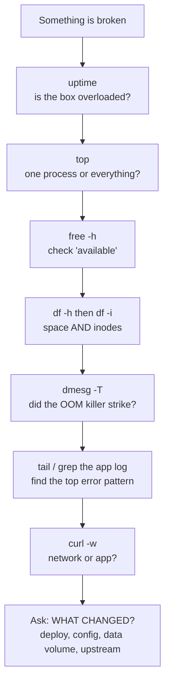

# Linux, from zero — the "explain it like I'm new" version

Forget the 20-command list. **A server is just a computer**, and every production problem is one of five things running out or getting stuck. If you understand *that*, the commands are just flashlights you point at each one.

---

## 🧠 The one mental model (learn this, everything else follows)

Think of a Linux server as a **restaurant kitchen**:

| Kitchen | Server | When it runs out… |
|---|---|---|
| 👨‍🍳 Cooks | **CPU** | Orders pile up, everything gets slow |
| 🧑‍🍳 Counter space | **Memory (RAM)** | No room to work — cook gets thrown out of the kitchen |
| 🧊 Pantry / freezer | **Disk** | Nowhere to store anything, writes fail |
| 🚪 Delivery door | **Network** | Ingredients arrive late or never |
| 📋 A cook standing frozen | **Stuck process** | Waiting on something that never came back |

**Every Linux troubleshooting question is: "which of these five is the problem?"**

Your job in the interview is to show you check them **in order, quickly**, instead of guessing. That's it. That's the whole skill.

---

## 🔧 The only 8 commands you need to know cold

I'm cutting the list down. Learn these eight, and you can handle 90% of what they'll ask.

### 1. `uptime` — "Is the server busy?"

```
$ uptime
 14:23:05 up 42 days,  load average: 0.52, 1.20, 3.40
```

**Plain English:** those three numbers are how many tasks were *waiting in line* over the last 1, 5, and 15 minutes.

**How to read it:** compare to how many CPUs the box has (`nproc` tells you). 4 CPUs and load of 4 = fully busy. Load of 20 = badly overloaded.

**The trick:** read them **left to right as a story.** `0.52, 1.20, 3.40` = it *was* bad 15 minutes ago and is recovering. `3.40, 1.20, 0.52` = it's getting worse right now. 

> 🗣️ Say in interview: *"First thing I check is `uptime` — not just the value but the trend across the 1, 5, and 15-minute averages, because that tells me if the problem is building or already recovering."*

---

### 2. `top` — "Who is eating the resources?"

Type `top`, press `q` to quit. It's a live list of running programs, busiest first.

**Only look at four things:**

| What you see | What it means |
|---|---|
| `%CPU` column | Who's burning the cooks |
| `%MEM` column | Who's eating counter space |
| `load average` (top line) | Same as uptime |
| `COMMAND` column | The name of the guilty program |

**That's it.** Sort by memory instead of CPU by pressing `Shift+M`. Press `Shift+P` to go back to CPU.

> 🗣️ *"`top` tells me whether one process is responsible or whether the whole box is saturated — that's a completely different investigation."*

---

### 3. `free -h` — "How much memory is left?"

```
$ free -h
              total   used   free   shared  buff/cache   available
Mem:           15Gi   9Gi    400Mi   100Mi      5Gi         5Gi
```

**The one thing beginners get wrong:** look at **`available`**, NOT `free`.

Linux borrows unused memory to cache files (that's `buff/cache`) because idle RAM is wasted RAM. It gives that back instantly when a program needs it. So `free` looking tiny is **normal and healthy**. `available` being tiny is the actual emergency.

> 🗣️ This single sentence makes you sound experienced: *"I look at `available`, not `free` — Linux deliberately uses spare RAM as file cache and releases it on demand, so low `free` isn't a problem by itself."*

---

### 4. `df -h` — "Is the disk full?"

```
$ df -h
Filesystem      Size  Used Avail Use% Mounted on
/dev/sda1        50G   50G    0G 100% /
/dev/sdb1       200G   80G  120G  40% /data
```

`100%` on any line = things are broken right now. Disk-full is the **single most common cause of batch job failures**, which is exactly your world.

**Then the follow-up that impresses people:** `df -i`

That checks **inodes** — the number of *files* allowed, separate from the space they take. A disk can be 20% full but 100% "inodes used" because something created 10 million tiny files. Writes fail with "No space left on device" while `df -h` looks totally fine. Junior engineers get completely stuck here.

**And to find what's eating it:**
```bash
du -sh /var/* | sort -h      # size of each thing under /var, smallest to biggest
```
`du` = "disk usage." `-sh` = summarize, human-readable. `sort -h` = sort those human numbers properly. Read the **bottom** of the output — that's your culprit. Then repeat one level deeper.

> 🗣️ *"Disk full is where I start on batch failures — `df -h` first, then `df -i` for inode exhaustion, which looks identical to the application but doesn't show up in a space check."*

---

### 5. `ps` — "Tell me about a specific process"

`top` is live. `ps` is a snapshot you can filter and pipe.

```bash
ps aux | grep airflow                          # is my thing even running?
ps aux --sort=-%mem | head -5                  # top 5 memory hogs
ps -eo pid,%cpu,%mem,etime,cmd --sort=-%cpu | head
```

That last one adds `etime` = **how long it's been running**. Gold for ops: a job that normally takes 10 minutes showing `etime` of `04:22:15` is your hung job.

Every process has a **PID** (a number, its ID). You use the PID to inspect or kill it.

---

### 6. Reading logs — `tail`, `grep`, and pipes

**A pipe (`|`) means "take the output of the left side and feed it into the right side."** That's the entire idea behind Linux. Small tools chained together.

```bash
tail -100 app.log                # last 100 lines (where the crash is)
tail -f app.log                  # follow live, new lines appear as they're written
grep ERROR app.log               # only lines containing "ERROR"
grep -i timeout app.log          # -i = ignore uppercase/lowercase
grep -c ERROR app.log            # just count them
grep -A5 -B5 "Exception" app.log # 5 lines After and Before each match, for context
```

**The one combo worth memorizing** (this is the "find the pattern" move):

```bash
grep ERROR app.log | sort | uniq -c | sort -rn | head
```

Read it right to left as a sentence: *find error lines → group identical ones together → count each group → sort by count, biggest first → show me the top 10.*

Output looks like:
```
  4821 ERROR connection timeout to partner-feed-07
    12 ERROR malformed XML
```
Now you know it's **one** upstream partner causing 4,821 errors, not a general problem. That's how you go from "the pipeline is broken" to "partner feed 07 is down" in fifteen seconds.

**One more, for modern servers:**
```bash
journalctl -u myservice --since "15 minutes ago"
```
`journalctl` is just "the log reader for services managed by systemd." `-u` = which service. Same idea as `tail`, different storage location.

---

### 7. `dmesg -T` — "Did the operating system itself kill something?"

```bash
dmesg -T | tail -30
dmesg -T | grep -i "killed process"
```

**Why this matters enormously:** when memory runs out, Linux doesn't crash — it **picks a program and kills it** to save itself. That's the **OOM killer** (Out Of Memory). The application's own log shows *nothing*, because it never got a chance to write anything. It just vanished.

So the symptom is: *"the job disappeared with no error in the app log."* If you know to run `dmesg`, you find:
```
Out of memory: Killed process 21883 (python) total-vm:8.2GB
```
Mystery solved in one command. **If you learn only one "advanced" thing from this whole section, learn this one** — it's the highest-payoff fact in Linux ops and it directly matches your resume line about the OOM killer taking out a job.

`-T` just converts cryptic timestamps into real dates.

---

### 8. `curl -w` — "Is it the network or the app?"

```bash
curl -o /dev/null -s -w 'dns:%{time_namelookup} connect:%{time_connect} total:%{time_total}\n' https://api.example.com
```

Plain English: "fetch this URL, throw away the content (`-o /dev/null`), stay quiet (`-s`), but **tell me how long each phase took**."

You get back something like `dns:0.004 connect:0.021 total:3.812`. DNS and connect were instant; the total was 3.8 seconds. **So the network is fine — the application is slow.** You just eliminated an entire team's worth of finger-pointing.

Flip it: `dns:2.9 connect:2.9 total:3.0` = the network/DNS is the problem, the app is fine.

> 🗣️ *"When someone says 'the service is slow,' I break the request into DNS, TCP connect, and time-to-first-byte with `curl -w` before I blame anyone — most 'network issues' turn out to be application or database latency."*

---

## 🗺️ The whole thing as one flow



**That last box is the most important one and requires zero technical skill.** 90% of production incidents are caused by a change. Deploy, config edit, a partner sending 10× the usual data, an upstream system going down, a certificate expiring, a disk slowly filling for three weeks.

> 🗣️ *"In parallel with the commands, I'm always asking 'what changed?' — a deploy, a config change, a data-volume spike, or something upstream. Systems that worked yesterday and fail today usually failed because something moved."*

---

## 🎯 Four facts that make you sound senior (memorize these four sentences, nothing more)

**1. Exit code 137 means killed for memory.**
When a program dies, it leaves a number. `137 = 128 + 9`, and signal 9 is `SIGKILL` — "die immediately, no negotiation." That's what the OOM killer and Kubernetes use. `143 = 128 + 15` = `SIGTERM`, the polite "please shut down" — that's a normal shutdown, not a crash.
> 🗣️ *"If I see exit code 137, I stop looking at application logic and start looking at memory limits."*

**2. Deleted files don't free space if a process still has them open.**
Someone runs `rm huge.log` to fix a full disk. `df` still says 100%. Why? Because the application still has the file open, so Linux keeps the space reserved until the process lets go. You find these with `lsof +L1`, and you fix it by restarting the process or emptying the file in place with `truncate -s 0 huge.log`. The real fix is log rotation.
> 🗣️ *"A classic disk-full trap: deleting a log doesn't reclaim space while a process still holds the file handle."*

**3. High load with low CPU means you're waiting on disk, not CPU.**
Load average counts tasks that are *waiting*, including waiting on disk I/O. So load of 30 with CPUs at 10% busy = your storage is the bottleneck, and adding CPUs would do nothing.
> 🗣️ *"High load average with low CPU utilization points me at I/O wait, not compute."*

**4. Why cron jobs fail when the same script works by hand.**
`cron` is the scheduler ("run this at 2 AM"). It runs with an almost empty environment — a minimal `PATH`, no variables from your `.bashrc`, and no terminal. So a script that works when *you* run it fails silently at 2 AM because `python` isn't on the path or a relative file path resolved somewhere else. Fix: use absolute paths everywhere, redirect output to a log file, and wrap it in `flock` so two runs can't overlap.
> 🗣️ *"Most cron failures I've debugged were environment differences — minimal PATH and missing env vars — not the script itself."* ← **You wrote cron jobs at Epsilon. This is genuinely your experience.**

---

## 🎤 Your Linux answer, in plain language

Simpler than the version I gave you before — say it in your own words, not memorized:

> "Linux is where I do most of my production work — I'm SSH'd into Linux hosts daily. At Epsilon I ran production support across 16 enterprise client environments, so when a pipeline broke, I was the person on the box.
>
> My habit is to work through it in a fixed order so I don't waste time guessing. I check whether the host itself is under stress, then whether one process is responsible, then memory and disk — disk-full and inode exhaustion caused a lot of our batch failures — and `dmesg` if a job vanished without writing an error, because that usually means the OOM killer took it. Then I go into the logs with `tail` and `grep`, and I group errors by frequency so I can tell whether it's one bad upstream feed or a systemic problem. And the whole time I'm asking what changed — a deploy, a config, a data-volume spike, or something upstream.
>
> On the automation side, I wrote the Bash scripts for our scheduled data-quality checks, log rotation, and pipeline health tests and ran them under cron, and I built the failover and recovery scripts that took our RTO from two hours down to thirty minutes. At Apple I've carried that forward — Linux and Bash diagnostic scripts built into runbooks for the recurring batch failures, which is where the 25% resolution-time improvement came from."

**Why this works:** you're describing *judgment and method*, which is what they're actually testing, and every claim maps to a real bullet on your resume. You are not claiming to be a kernel engineer.

---

## 🛡️ If they push deeper than you can go

They will ask one follow-up you can't answer. That's normal and expected. Use this:

> "I haven't gone that deep — my Linux work is operational troubleshooting and automation rather than kernel or systems-level tuning. Here's how I'd approach finding out, though…"

Then reason out loud. **An honest boundary plus visible reasoning beats a confident wrong answer every single time.** Interviewers are specifically listening for whether you'll bluff, because bluffing during a real incident causes outages.

---

## ⏱️ 30 minutes tonight to make this real

You need a Linux box. Your Mac terminal is close but different (`free`, `dmesg`, `journalctl` don't exist there). Use Docker:

```bash
docker run -it --rm ubuntu bash
apt update && apt install -y procps vim curl
```

Now run these in order and just *look* at the output — you're building recognition, not memorizing:

```bash
uptime                          # see the three load numbers
top                             # then press Shift+M, then Shift+P, then q
free -h                         # find 'available' vs 'free' with your eyes
df -h                           # find the Use% column
df -i                           # notice it's a DIFFERENT number
ps aux --sort=-%mem | head -5
nproc                           # how many CPUs — context for load average

# make a fake log and practice the money combo
printf 'ERROR timeout feed-07\nERROR timeout feed-07\nERROR bad xml\nINFO ok\n' > app.log
grep -c ERROR app.log
grep ERROR app.log | sort | uniq -c | sort -rn
tail -2 app.log
du -sh /var/* | sort -h
```

Then, on your Mac (not in the container), run the curl one against any site and watch the timings:
```bash
curl -o /dev/null -s -w 'dns:%{time_namelookup} connect:%{time_connect} total:%{time_total}\n' https://apple.com
```

**Do this twice.** After the second pass, when they ask "how do you troubleshoot a Linux server," you won't be reciting — you'll be describing something your hands have actually done this weekend. That's a completely different tone of voice, and interviewers hear it immediately.
