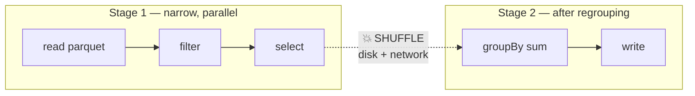
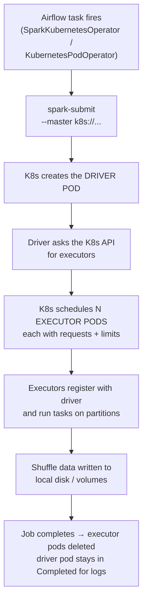

# 🔥 Friday Night: Spark, from absolute zero

**One blunt calibration note, then we go.** "Rusty" and "never did it" get treated the same way tonight — we rebuild from first principles. But understand the rule for Tuesday: **you can speak in past tense about outcomes you owned (pipelines, alerting, incidents, reliability numbers), and you must speak carefully about tools.** Matthew has written Spark for years. If you claim "I tune Spark jobs daily," his second question ends you. Tonight's goal is not fake expertise — it's **real conceptual fluency plus 90 minutes of hands-on**, so that every sentence you say is defensible. That combination genuinely passes. Bluffing genuinely doesn't.

---

## 🕐 Tonight's plan (3 hours, in this order)

| Time | Block | What you get |
|---|---|---|
| 0:00–0:50 | **§1 The kitchen** — Spark explained like you're 5 | The mental model everything hangs off |
| 0:50–1:05 | **§2 Vocabulary** | 15 words you must be able to say naturally |
| 1:05–2:00 | **§3 Hands-on** — install PySpark, run 7 exercises | "I ran this last night" is a true sentence |
| 2:00–2:20 | **§4 Spark on Kubernetes** | His exact stack |
| 2:20–2:35 | **§5 Failure catalog + Spark UI** | Sounds like ops experience |
| 2:35–3:00 | **§6 Scripted answers, out loud** | The actual deliverable |
| 3:00+ | **§7 Flashcards, §8 Cheat card** | Tomorrow's warm-up |

---

# §1 — Spark explained like you're 5

## The problem Spark exists to solve

You have a spreadsheet with **50 billion rows**. It's 4 terabytes. Your laptop has 16 GB of RAM.

Excel: dead. Pandas: dead. A single database: crawling.

**Spark's answer:** don't use one computer. Use 100 computers. Cut the data into 100 pieces, give each computer one piece, have them all work at the same time, then combine the answers.

That's it. **Spark is "many computers working on pieces of one big dataset at the same time."** Every single Spark concept, config knob, and failure exists to manage that basic idea.

---

## The cast of characters (the kitchen)

Imagine a restaurant kitchen with a giant delivery of vegetables to chop.

| Kitchen | Spark | What it does |
|---|---|---|
| 🧑‍🍳 **Head chef** with the recipe | **Driver** | Reads your code, makes the plan, splits work into tasks, hands them out, collects results. **One per job.** |
| 👨‍🍳 **Line cooks** | **Executors** | Do the actual chopping. Each holds its own memory and CPU. **Many per job.** |
| 📦 **Boxes of vegetables** | **Partitions** | The data, cut into chunks. One cook works one box at a time. |
| 🍽️ **One box being chopped** | **Task** | The smallest unit of work. **One task per partition.** |
| 👔 **Restaurant manager assigning cooks** | **Cluster manager** (Kubernetes / YARN) | Decides which machines the cooks run on |

**Two things follow from this that you should say out loud in the interview:**

1. **The driver is a single point of failure.** If the head chef collapses, the whole job dies. This is why `collect()` is dangerous — it means "every cook, send all your chopped vegetables to the head chef's tiny desk." The desk overflows, the chef dies, the job dies.
2. **Number of partitions = how much parallelism you can get.** 4 partitions with 100 cooks means 96 cooks stand around doing nothing. 500,000 partitions means the chef spends all day writing tickets instead of cooking. Both are bad. **Right-sizing partitions is most of Spark tuning.**

> 🗣️ **Say this:** *"Spark is a driver plus executors — the driver plans and schedules, executors do the work on partitions, and one task runs per partition. Most performance problems come down to partition sizing and shuffles."*

---

## Lazy evaluation — the shopping list

Here's something that confuses every beginner.

```python
df = spark.read.parquet("s3://data/orders")   # nothing happens
df2 = df.filter(df.amount > 100)              # nothing happens
df3 = df2.groupBy("customer_id").sum("amount")# STILL nothing happens
df3.write.parquet("s3://out/")                # ← NOW everything runs
```

**Analogy:** the first three lines are you **writing a shopping list**. The last line is you **actually driving to the store**.

- **Transformations** = adding to the list. `select`, `filter`, `join`, `groupBy`, `withColumn`. Free. Instant. Nothing runs.
- **Actions** = go do it. `write`, `count`, `show`, `collect`, `take`. **This is what triggers real work.**

**Why this matters practically** (and this is a real ops insight, not trivia): a Spark job appears to fly through 200 lines of code in 2 seconds and then hangs for 40 minutes on one line. Beginners blame that line. It's not that line — that's just the **first action**, and it's executing everything you queued up before it.

**Bonus payoff:** because Spark sees the whole list before shopping, it can optimize it — reorder your filters, drop columns you never use, merge steps. That optimizer is called **Catalyst**. You don't need to know more than the name and that concept.

> 🗣️ **Say this:** *"Transformations are lazy — nothing executes until an action. That's why the first action in a job appears to take all the time, and it's also what lets Catalyst optimize the whole plan, like pushing filters down before the read."*

---

## 🔥 The shuffle — the single most important concept in Spark

If you learn **one** thing tonight, learn this. 80% of Spark's slowness and failures trace back to shuffles.

Two kinds of work exist:

### Narrow — each cook works alone ✅

```
Cook 1: box A → chopped A
Cook 2: box B → chopped B
Cook 3: box C → chopped C
```
`filter`, `select`, `withColumn`, `map`. No one talks to anyone. **Fast. Cheap. Parallel.**

### Wide — everyone has to rearrange ❌

Now the recipe says: *"group all the carrots together, all the onions together, all the peppers together."*

But carrots are scattered across all 100 boxes. So **every cook has to send carrot pieces to whichever cook is handling carrots**, and receive their assigned vegetable from all 99 others.

That mass redistribution is a **shuffle**. It means:
- Writing intermediate data **to disk**
- Sending it **over the network**
- Every cook **waiting** for everyone else to finish sending

**What causes a shuffle:** `groupBy`, `join`, `distinct`, `orderBy`, `repartition`, `reduceByKey`. Any operation where a row's destination depends on its *value*.

**Why you care:** disk + network are 100–1000× slower than memory. A shuffle is where your job goes from minutes to hours, and where it runs out of memory.

### Stages and tasks — now they make sense

Spark chops your job at every shuffle boundary:

- **Job** = one action (one `write`, one `count`)
- **Stage** = a chunk of work with no shuffle inside it. **New shuffle = new stage.**
- **Task** = one partition's worth of work inside a stage



> 🗣️ **Say this — it makes you sound like you've actually debugged Spark:** *"When I look at a slow job I go straight to the stage boundaries, because every boundary is a shuffle where data hits disk and network. That's almost always where the time and the memory failures are."*

---

## 🥕 Data skew — the #1 real-world Spark failure

Back to the kitchen. You group by vegetable type. There are 200 cooks.

But the delivery was **90% carrots**.

The cook assigned to carrots gets 90% of all the food. 199 cooks finish in 30 seconds and stand around. One cook works for 4 hours, then his counter overflows and he gets thrown out of the kitchen.

**That's data skew.** In real data: you `groupBy customer_id` and one customer is Walmart. You `groupBy country` and 60% is `US`. You join on a key where 40% of rows have `NULL`.

**The symptom that identifies it instantly:** in the Spark UI, one stage shows *199 tasks done in 20 seconds, 1 task running for 40 minutes* — or one or two executors die with OOM while the rest are fine.

**Three fixes (name them, this is high-signal):**

| Fix | ELI5 |
|---|---|
| **Salting** | Split the carrot pile artificially: relabel as `carrot_1`, `carrot_2`... `carrot_10` so ten cooks share it, aggregate the partials, then combine. In code: append a random 0–N suffix to the hot key, aggregate, then aggregate again without the suffix. |
| **AQE skew join** | Spark 3+ can detect the giant partition **at runtime** and auto-split it. `spark.sql.adaptive.enabled=true` + `skewJoin.enabled=true`. Often the whole answer. |
| **Broadcast join** | If the *other* side of the join is small, skip the shuffle entirely (next section) |

Also: **filter out junk keys first.** A huge amount of real skew is `NULL` or `-1` or `""` on the join key. Filtering those before the join is free and often fixes everything.

---

## 📣 Broadcast join — the easiest big win

You're joining a **10-billion-row fact table** to a **200-row country lookup table**.

- **Default (shuffle join):** shuffle *both* tables across the network so matching keys land together. Absurdly expensive — you moved 10 billion rows to match against 200.
- **Broadcast join:** photocopy the 200-row table and hand a copy to **every cook**. Now each cook joins its own box locally. **Zero shuffle.**

```python
from pyspark.sql.functions import broadcast
big.join(broadcast(small), "country_code")
```

Spark auto-broadcasts under `spark.sql.autoBroadcastJoinThreshold` (default 10 MB), but it can only do that when it *knows* the size — stale statistics mean it guesses wrong, which is why explicit `broadcast()` hints exist.

**The trap to mention:** broadcast too big a table and you OOM **the driver** (which collects it first) and **every executor** (which each hold a full copy).

> 🗣️ *"On large-to-small joins I check whether it's broadcasting — turning a shuffle join into a broadcast join on a dimension table is usually the single biggest win available."*

---

## 🧠 Memory — the part that causes the OOM question

A Spark executor running in a container has memory split into pieces. ELI5 version:

```
┌──────────────── Container / pod memory limit ─────────────────┐
│                                                               │
│   spark.executor.memory          (the JVM heap)               │
│   ├─ Execution memory  → shuffles, joins, sorts (temporary)   │
│   └─ Storage memory    → cached DataFrames                    │
│      (these two share a pool and borrow from each other)      │
│                                                               │
│   spark.executor.memoryOverhead  (OFF-heap, ~10% default)     │
│   ├─ JVM internals, network buffers                           │
│   └─ 🔥 PySpark worker processes live HERE                    │
└───────────────────────────────────────────────────────────────┘
```

**The counter analogy:** `executor.memory` is the counter space. `memoryOverhead` is the space around it for tools, the trash bin, and the Python assistant standing there. If the *whole kitchen* is smaller than counter + tools + assistant, the fire marshal (the Linux kernel) shuts you down.

**The three facts that make you sound experienced:**

1. **The pod's memory limit must be ≥ `executor.memory` + `memoryOverhead`.** If it isn't, the kernel kills the container **before Spark ever gets a chance to spill to disk** — you lose Spark's own graceful degradation.
2. **PySpark makes this worse.** Python UDFs run in separate Python processes outside the JVM heap, charged to **overhead**. The classic bug: "my Scala job worked, my Python version OOMs." Default 10% overhead is frequently not enough for PySpark.
3. **Spilling is normal, not a bug.** When execution memory fills, Spark writes to local disk ("spill") and keeps going — slower but alive. Heavy spill in the UI = your partitions are too big. Actual death = the container ceiling was hit.

**And know these are three different failures:**

| What you see | What it means | Where you see it |
|---|---|---|
| `Reason: OOMKilled`, **exit code 137** | Container breached its memory **limit**; the kernel killed it | `kubectl describe pod` → Last State |
| `Reason: Evicted` | The **node** ran out of memory/disk; not the pod's fault | `kubectl describe pod` → Events |
| `java.lang.OutOfMemoryError` | Inside the **JVM heap** — Spark itself failed to allocate | Driver/executor **logs** |

---

## A few more one-line concepts worth having

| Concept | ELI5 |
|---|---|
| **`repartition` vs `coalesce`** | `repartition(200)` = full reshuffle, can go up or down, expensive but even. `coalesce(10)` = just glue neighboring boxes together, no shuffle, **down only**, can leave uneven sizes. |
| **`cache()` / `persist()`** | Keep the chopped vegetables on the counter instead of re-chopping from the pantry. **Only worth it if you reuse the DataFrame 2+ times** — otherwise it's wasted memory. Remember to `unpersist()`. |
| **Partition pruning** | Data on disk stored in folders like `/date=2026-08-20/`. Filter on `date` and Spark **doesn't even open** the other folders. This is why you partition tables by date. |
| **Predicate / column pushdown** | Parquet and Iceberg let Spark skip columns and row-groups **at the file level** — read 2 columns out of 200, don't read at all then throw away. |
| **Small-file problem** | 100,000 tiny 1 MB output files instead of 500 good ones. Every read pays per-file overhead; listing alone becomes the bottleneck. Fix by `coalesce`/`repartition` before write, or compaction jobs (Iceberg has this built in). |
| **Target partition size** | Aim roughly **128–200 MB per partition**. Too big → OOM and spill. Too small → scheduling overhead dominates. |
| **`spark.sql.shuffle.partitions`** | Default **200**. The number of partitions *after* a shuffle. The most commonly tuned knob in all of Spark — 200 is right for medium data, way too low for TBs, way too high for tiny data. |
| **AQE (Adaptive Query Execution)** | Spark 3+ re-optimizes **while running** using real observed sizes: coalesces too-small shuffle partitions, converts joins to broadcast, splits skewed partitions. Turn it on. |
| **Dynamic allocation** | Spark adds/removes executors based on demand instead of holding a fixed fleet. Saves money on bursty workloads. |
| **RDD vs DataFrame** | RDD = old low-level API, you hand-optimize. DataFrame/Dataset = has a schema, goes through Catalyst, much faster. **Use DataFrames.** Say: *"I work with the DataFrame API; RDDs are the older lower-level API that bypasses Catalyst."* |
| **Spark SQL** | You can write literal SQL against DataFrames: `df.createOrReplaceTempView("orders")` then `spark.sql("SELECT ...")`. Identical performance to the DataFrame API — same optimizer. **Great for you, since your SQL is the thing you'll rebuild fastest.** |

---

# §2 — The 15 words you must be able to say naturally

Read this list out loud twice. You don't need to lecture on them — you need them to fall out of your mouth without hesitation, because *hesitation on vocabulary* is what reveals inexperience, not lack of depth.

**driver** · **executor** · **partition** · **task** · **stage** · **shuffle** · **narrow / wide transformation** · **lazy evaluation** · **action** · **skew** · **broadcast join** · **spill** · **memoryOverhead** · **OOMKilled / exit 137** · **AQE**

Fluency test — can you finish each of these sentences instantly?
- "Every shuffle creates a new ___" → *stage*
- "One task per ___" → *partition*
- "Nothing runs until an ___" → *action*
- "One partition much bigger than the rest is ___" → *skew*
- "PySpark worker processes are charged to ___" → *memoryOverhead*
- "Exit code 137 means ___" → *the container was killed for exceeding its memory limit (OOMKilled)*

---

# §3 — Hands-on, 55 minutes (this is the part that makes it real)

You need PySpark on your Mac. Java first, then pip.

```bash
# ~5 minutes
brew install openjdk@17
sudo ln -sfn /opt/homebrew/opt/openjdk@17/libexec/openjdk.jdk /Library/Java/JavaVirtualMachines/openjdk-17.jdk
java -version                      # confirm it prints 17.x

python3 -m venv ~/sparklab && source ~/sparklab/bin/activate
pip install pyspark==3.5.1
pyspark                            # opens an interactive Spark shell — you now have a REAL Spark session
```

When `pyspark` starts, it prints a line like `Spark context Web UI available at http://localhost:4040`. **Open that in your browser and leave it open** — you'll look at it in Exercise 7.

Now type these **by hand** (do not copy-paste; typing is what builds recall).

### Exercise 1 — make data, see partitions

```python
df = spark.range(0, 1_000_000).toDF("id")
df.rdd.getNumPartitions()          # how many chunks Spark split it into
df.count()                         # ← your first ACTION. Watch it actually run.
```

### Exercise 2 — prove laziness with your own eyes

```python
big = spark.range(0, 50_000_000).toDF("id")
filtered = big.filter("id % 7 = 0")        # instant — nothing happened
withcol  = filtered.withColumn("double", filtered.id * 2)   # instant
withcol.count()                            # ← THIS takes seconds. That's the action.
```
🧠 **Feel it:** two lines returned instantly, the third did all the work. That's lazy evaluation. You've now personally observed it.

### Exercise 3 — narrow vs wide, and see the plan

```python
from pyspark.sql.functions import col, count, sum as _sum

orders = spark.createDataFrame([
    (1, "US", 100.0), (2, "US", 250.0), (3, "IN", 75.0),
    (4, "UK", 300.0), (5, "US", 50.0),  (6, "IN", 125.0),
], ["order_id", "country", "amount"])

narrow = orders.filter(col("amount") > 80)
narrow.explain()          # look for: Filter ... Scan   — no Exchange

wide = orders.groupBy("country").agg(count("*").alias("n"), _sum("amount").alias("total"))
wide.explain()            # 🔥 look for the word "Exchange" — THAT IS THE SHUFFLE
wide.show()
```
🧠 **The single most useful skill you'll learn tonight:** `explain()` and looking for **`Exchange`**. Exchange = shuffle = expensive. Being able to say *"I read the physical plan and look for Exchange nodes"* is a real practitioner sentence.

### Exercise 4 — build skew and watch it

```python
from pyspark.sql.functions import when, rand, lit, concat

# 95% of rows on one key = skew
skewed = (spark.range(0, 2_000_000).toDF("id")
          .withColumn("customer", when(col("id") % 20 == 0, lit("normal_cust"))
                                  .otherwise(lit("WALMART"))))

skewed.groupBy("customer").count().show()     # see the imbalance
```
Now **salt it** — this is the fix, and doing it once means you can describe it credibly:
```python
from pyspark.sql.functions import floor

salted = skewed.withColumn("salt", floor(rand() * 10))
step1 = salted.groupBy("customer", "salt").count()          # 10 cooks share Walmart
step2 = step1.groupBy("customer").sum("count")              # combine the partials
step2.show()
```
🧠 **You just implemented salting.** You can now honestly say: *"I've salted a hot key — aggregate with a random salt, then re-aggregate to combine the partials."*

### Exercise 5 — broadcast join vs shuffle join

```python
from pyspark.sql.functions import broadcast

countries = spark.createDataFrame(
    [("US", "United States"), ("IN", "India"), ("UK", "United Kingdom")],
    ["country", "name"])

orders.join(countries, "country").explain()              # may show SortMergeJoin + Exchange
orders.join(broadcast(countries), "country").explain()   # 🔥 BroadcastHashJoin, no Exchange
```
🧠 You've now *seen* a shuffle disappear from a query plan. That's the whole point of a broadcast join.

### Exercise 6 — shuffle partitions + Spark SQL

```python
spark.conf.get("spark.sql.shuffle.partitions")     # 200 — the famous default
spark.conf.set("spark.sql.shuffle.partitions", 8)  # sane for tiny local data

orders.createOrReplaceTempView("orders")
spark.sql("""
    SELECT country,
           COUNT(*)   AS orders,
           SUM(amount) AS revenue,
           AVG(amount) AS avg_order
    FROM orders
    GROUP BY country
    HAVING COUNT(*) > 1
    ORDER BY revenue DESC
""").show()
```
🧠 **Double win:** you're practicing Spark *and* the exact SQL topics on his list. `GROUP BY`, aggregations, `HAVING` — all live in Spark SQL identically.

### Exercise 7 — read the Spark UI (do not skip this)

Go to **http://localhost:4040**. Click **Jobs**, then click into a job, then a **Stage**.

Find these four things with your own eyes:

| Look for | What it tells you |
|---|---|
| **Number of stages** in a job | How many shuffles happened |
| **Duration**: Min / **Median** / Max task time | Median far below Max = **skew** |
| **Shuffle Read / Shuffle Write** size | How much data crossed the network |
| **Spill (Memory) / Spill (Disk)** | Non-zero = partitions too big for memory |

🧠 **This is the money sentence for Tuesday:** *"In the Spark UI I go to the stage detail and compare median task duration to max — if max is 20× median, that's skew, not a resource problem. And I check shuffle read size and spill, because heavy spill means my partitions are too large."* That sentence is now **true** — you did it tonight.

### Optional 10 minutes — force a real OOM

```python
# in a fresh terminal
pyspark --driver-memory 512m
```
```python
huge = spark.range(0, 200_000_000).toDF("id")
huge.collect()          # 💥 driver dies — this is exactly why you never collect() big data
```
🧠 You've now killed a driver with `collect()`. You can describe it from experience.

---

# §4 — Spark on Kubernetes (Matthew's exact stack)

He runs **Spark in Kubernetes pods, orchestrated by Airflow**. Understand this flow and you're speaking his language.



**Things to know about this specifically:**

- **Every Spark component is a pod.** So `kubectl` is your debugger: `kubectl get pods` shows the driver plus executors; `kubectl logs <driver-pod>` has the stack trace; `kubectl describe pod <executor>` tells you *why* it died.
- **`cluster` vs `client` deploy mode:** cluster mode = driver runs inside the cluster as a pod (what you want in production). Client mode = driver runs where you submitted from (fine for notebooks/dev).
- **Requests vs limits carry over directly:** the executor pod's memory **limit** must cover `executor.memory + memoryOverhead`. This is *the* bridge between the Spark question and the Kubernetes question, and it's why the OOM scenario is such a good question — it tests both at once.
- **Spark's own K8s conveniences:** `spark.kubernetes.executor.request.cores`, `spark.kubernetes.memoryOverheadFactor`, and namespaces/ResourceQuotas so one bad job can't eat the cluster.
- **Why he built it this way** (from his profile: *"packaged JAR portable to another orchestrator without Airflow dependencies"*): the Spark job is a self-contained container/JAR; Airflow only *triggers* it. Clean separation — you could swap Airflow for anything.

> 🗣️ **Say this if K8s + Spark come up together:** *"The nice thing about Spark on Kubernetes is that every component is a pod, so debugging uses the same tools as everything else — `describe` the executor pod for the kill reason, `logs --previous` for the container that died. And it forces you to be explicit about resources, because the pod limit has to cover executor memory plus overhead, or the kernel kills the container before Spark can even spill."*

---

# §5 — Failure catalog (ops framing = your strongest angle)

This table is your differentiator. He's a builder; you're pitching yourself as the person who **operates** what he builds.

| Symptom | Likely cause | Fix |
|---|---|---|
| One task runs 20× longer than the others | **Skew** | Salt the key, enable AQE skew join, broadcast the small side, filter NULL/junk keys |
| Executor pod `OOMKilled`, exit 137 | Pod limit < `executor.memory` + overhead; or partitions too big; or Python UDF overhead | Raise `memoryOverhead` + pod limit, fewer `executor.cores`, more shuffle partitions |
| **Driver** dies with OOM | `collect()` / `toPandas()` on big data, or a broadcast that was too large | Never collect big data — write to storage; lower broadcast threshold |
| `Executor lost` / heartbeat timeout | Node pressure, spot/preemptible reclaim, GC pause, network | Check node events; longer heartbeat timeout; avoid spot for drivers |
| Job hangs at 199/200 tasks | Skew (the classic signature) | Same as skew |
| Huge `Spill (Disk)` in UI | Partitions too big for execution memory | Increase `shuffle.partitions`, more memory, less per-task data |
| Job was fast, now slow, no code change | **Data volume grew**, or thousands of small files accumulated, or stale stats stopped broadcast | Compaction, re-tune partitions, refresh statistics |
| Output is 50,000 tiny files | Too many output partitions | `coalesce()` before write; Iceberg compaction |
| Duplicated rows after a retry | Task wasn't **idempotent** — appended instead of overwriting | Overwrite the partition; key on natural key |
| `Task not serializable` | Closure captured something non-serializable | Move object creation inside the executor function |

**The last two are yours to own.** Idempotency and data-correctness-after-retry are *data operations* problems, not Spark-internals problems — precisely the seat you're interviewing for.

---

# §6 — Your scripted answers (say each one OUT LOUD tonight)

Reading these silently does approximately nothing. **Say them at speaking volume.** Twice each.

### Q1: "What's your experience with Spark?" — the honest, strong version

> "My Spark exposure is on the operations and pipeline side rather than as the primary job author. At Sports Excitement I owned 50+ daily Airflow ETL pipelines where the heavy processing was distributed — my responsibility was the reliability envelope around them: retry logic, SLA-breach alerting into PagerDuty, automated failure recovery, making sure reruns were idempotent so a retry didn't double-write data. I also did the storage-side tuning that Spark jobs depend on — partition schemas and storage tiers on Azure Data Lake, which took query latency from about 1.2 seconds down to 550 milliseconds.
>
> On PySpark and Databricks specifically I've built pipelines in project work — a real-time ingestion and ML scoring pipeline on Databricks with PySpark for distributed feature engineering.
>
> I'll be straight about the boundary: I'm solid on the model — driver and executors, partitions, lazy evaluation, where the shuffles are, how skew shows up as one long-running task, the memory-plus-overhead relationship to a pod's limit — and I've been hands-on refreshing that. But I haven't been the person owning multi-terabyte job tuning day to day. Where I'm strongest is being the operator: catching the failure, triaging it fast, and closing the loop so it doesn't recur."

**Why this works:** it's honest, it's specific, and it lands you exactly where he needs help. He's a builder with a data-quality background — he knows builders don't want to be the on-call person. **You are volunteering to be the on-call person.** That's an attractive offer, not a weakness.

### Q2: "Walk me through what happens when a Spark job runs"

> "The driver starts up and builds a logical plan from my code. Nothing actually executes until an action — a write or a count — because transformations are lazy. When the action fires, Catalyst optimizes the plan, and Spark breaks the job into stages, splitting at every shuffle boundary. Each stage becomes a set of tasks, one per partition, distributed across executors. Narrow work like filters and selects stays local to a partition; wide work like groupBy or join has to redistribute data across the network, which is the shuffle. Results come back to the driver or get written out. On Kubernetes, the driver and each executor are pods, so all of that is visible through `kubectl` and the Spark UI."

### Q3: "Your Spark job used to take 20 minutes, now it takes 3 hours. What do you do?"

> "First question: what changed? Code, config, data volume, or something upstream. Most of the time it's data volume or file layout, not code.
>
> Then I'd open the Spark UI and find *where* the time went — which stage, and compare median task duration to max. If max is dramatically higher than median, that's skew and I'd look at key distribution on the join or groupBy. If tasks are uniformly slow, I'd look at shuffle read/write sizes and spill: heavy spill means partitions grew past what execution memory can hold, and I'd raise `spark.sql.shuffle.partitions` so each task handles less.
>
> I'd also check the input side — did we start reading tens of thousands of small files instead of a few large ones? That's a very common silent regression, and the fix is compaction, not more compute. And I'd check whether a join that used to broadcast stopped broadcasting because the dimension table crossed the threshold or statistics went stale.
>
> Then I'd read `explain()` on the plan and look for unnecessary Exchange nodes — sometimes a filter moved after a join and the fix is just doing less work earlier."

### Q4: "Spark on Kubernetes, pods being killed for memory" — the flagship

**Use the answer from my previous message verbatim.** It's your single strongest technical response. Say it out loud twice tonight. The structure is: *confirm which kill (137 vs Evicted vs JVM OOM) → scope it (driver vs executors, all vs one = skew) → what changed → Spark UI evidence (max vs median, spill) → the memory math (pod limit ≥ memory + overhead, PySpark lives in overhead) → immediate mitigation → real fix (skew/broadcast/UDFs/partition sizing) → prevention (alerts on OOM count and spill, ResourceQuota, runbook, post-incident review).*

### Q5: "What's your approach to making pipelines reliable?" — your *best* question, own it

> "Four things, and they're roughly in priority order.
>
> **Idempotency first** — every task has to produce the same result if it's rerun, because retries and backfills are guaranteed. Practically that means overwriting the target partition instead of appending, keying writes on a natural key, and using the run's data interval rather than the current timestamp. Non-idempotent tasks turn an ordinary retry into a data-quality incident.
>
> **Then retries with backoff and real alerting** — retries on the task, exponential backoff so we don't hammer a struggling upstream, SLA callbacks wired to PagerDuty. That's how we got mean response under five minutes on 50+ daily DAGs at 99.8% reliability.
>
> **Then validation before the data is trusted** — pre-deployment data-quality checks and load testing cut our post-release pipeline failures 28%. And I alert on the *data*, not just the job: freshness, row-count deltas versus baseline, null rates, schema drift, duplicate rate. A job can exit zero and still have written garbage, and job-status alerting never catches that.
>
> **Then the human layer** — a runbook per alert so whoever's on call at 3 a.m. isn't reverse-engineering the system, and a blameless post-incident review. At Epsilon that got repeat incident categories down 50%."

🔥 That answer maps onto **four years of his career** — he built metrics with thresholds to alert stakeholders about data issues. If you deliver one answer well tonight, make it this one.

---

# §7 — Flashcards (cover the right column, test yourself)

| Question | Answer |
|---|---|
| Driver vs executor? | Driver plans/schedules/collects, one per app; executors do the work on partitions, many |
| One task = ? | One partition |
| Transformation vs action? | Transformations lazy (build the plan); actions trigger execution |
| Name 4 actions | `count`, `show`, `collect`, `write` (also `take`, `first`) |
| Narrow vs wide? | Narrow = partition-local (`filter`,`select`); wide = requires shuffle (`groupBy`,`join`,`distinct`,`orderBy`) |
| What creates a new stage? | A shuffle boundary |
| What word in `explain()` means shuffle? | `Exchange` |
| Skew signature in the UI? | Max task duration ≫ median; job stuck at 199/200 |
| 3 skew fixes | Salting, AQE skew join, broadcast the small side (+ filter junk keys) |
| Broadcast join? | Copy the small table to every executor → no shuffle |
| Broadcast risk? | Too big → OOM the driver and every executor |
| `repartition` vs `coalesce`? | `repartition` shuffles, up or down; `coalesce` no shuffle, down only |
| Default `spark.sql.shuffle.partitions`? | 200 |
| Target partition size? | ~128–200 MB |
| Where do PySpark workers get charged? | `memoryOverhead` (off-heap) |
| Pod memory limit must cover? | `executor.memory` + `memoryOverhead` |
| Exit code 137? | OOMKilled — container exceeded its memory limit |
| `Evicted` vs `OOMKilled`? | Evicted = node-level pressure; OOMKilled = this pod's limit |
| What is spill? | Spark writing intermediate data to local disk when memory fills — slow but survivable |
| Why never `collect()` big data? | Pulls everything to the single driver → driver OOM → job dies |
| What is AQE? | Runtime re-optimization: coalesce partitions, convert to broadcast, split skewed partitions |
| Catalyst? | Spark's query optimizer |
| RDD vs DataFrame? | RDD = low-level, no optimizer; DataFrame = schema + Catalyst, use this |
| Partition pruning? | Skip entire folders/files based on partition-column filters |
| Small-file problem? | Too many tiny files → per-file overhead dominates reads; fix with compaction |
| Cache when? | Only when reusing a DataFrame 2+ times; `unpersist()` after |

---

# 🃏 §8 — Spark cheat card (tomorrow's 5-minute warm-up)

**Model:** driver plans → executors run tasks → 1 task per partition → stages split at shuffles.
**Lazy:** transformations free, **actions** execute. First action appears to "take all the time."
**Shuffle = disk + network.** Caused by `groupBy`, `join`, `distinct`, `orderBy`, `repartition`. Shows as **`Exchange`** in `explain()`.
**Skew** = one giant partition → max task ≫ median → **salt / AQE skewJoin / broadcast / filter NULL keys**.
**Broadcast join** = copy small table everywhere, zero shuffle; too big → driver + executor OOM.
**Memory:** pod limit ≥ `executor.memory` + `memoryOverhead`; **PySpark lives in overhead**; spill = normal, OOMKill = ceiling hit.
**Three kills:** `137/OOMKilled` = pod limit · `Evicted` = node pressure · `java.lang.OutOfMemoryError` = JVM heap.
**Knobs:** `spark.sql.shuffle.partitions` (default 200) · `executor.memory` / `memoryOverhead` / `executor.cores` · `spark.sql.adaptive.enabled` · `autoBroadcastJoinThreshold`.
**Never:** `collect()` big data · blind-append in a retryable task · ignore small files.
**UI triage:** stages → **median vs max task time** (skew) → shuffle read/write → **spill**.
**Your seat:** *operator*, not job author — idempotency, retries + backoff, data-level alerting (freshness / volume / nulls / schema drift), runbooks, post-incident reviews.

---

## Before you sleep — 3 things

1. **Actually run §3.** Even 30 minutes of it. Exercises 3, 4, and 7 (`explain()` → find `Exchange`, build skew, read the UI) are worth more than re-reading this whole document. Every claim in §6 becomes defensible the moment you've typed them.
2. **Say Q1 and Q5 out loud.** Those two carry the interview. Q1 keeps you honest and safe; Q5 is where you're genuinely the strongest candidate.
3. **Don't creep past 3 hours.** Sleep matters more than one extra concept — and Saturday is Airflow, which is the other half of his headline.

Tell me when you're done and I'll build Saturday's **Airflow deep dive** at the same ELI5 depth.
